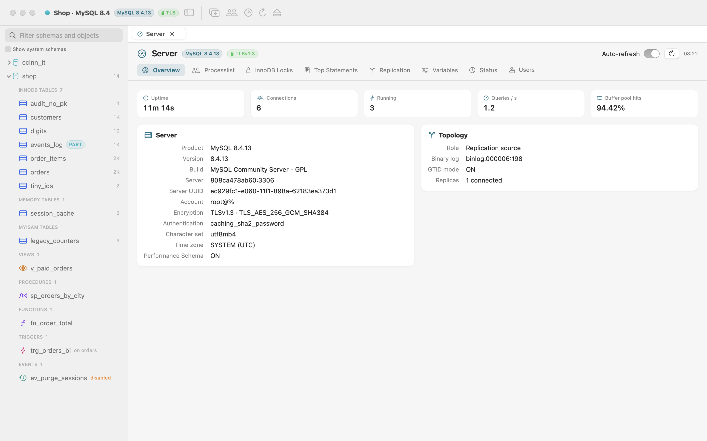
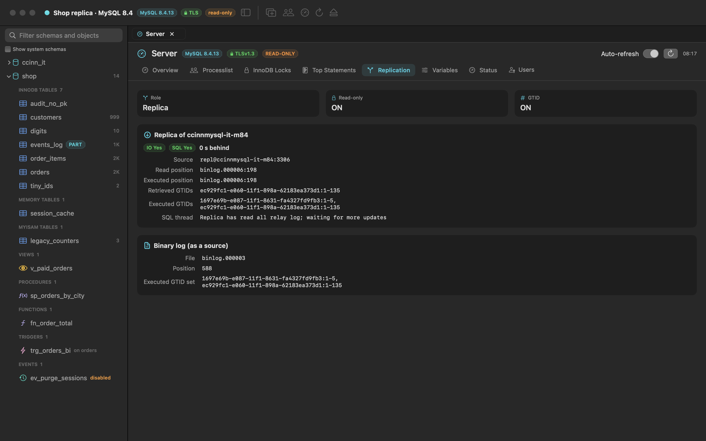
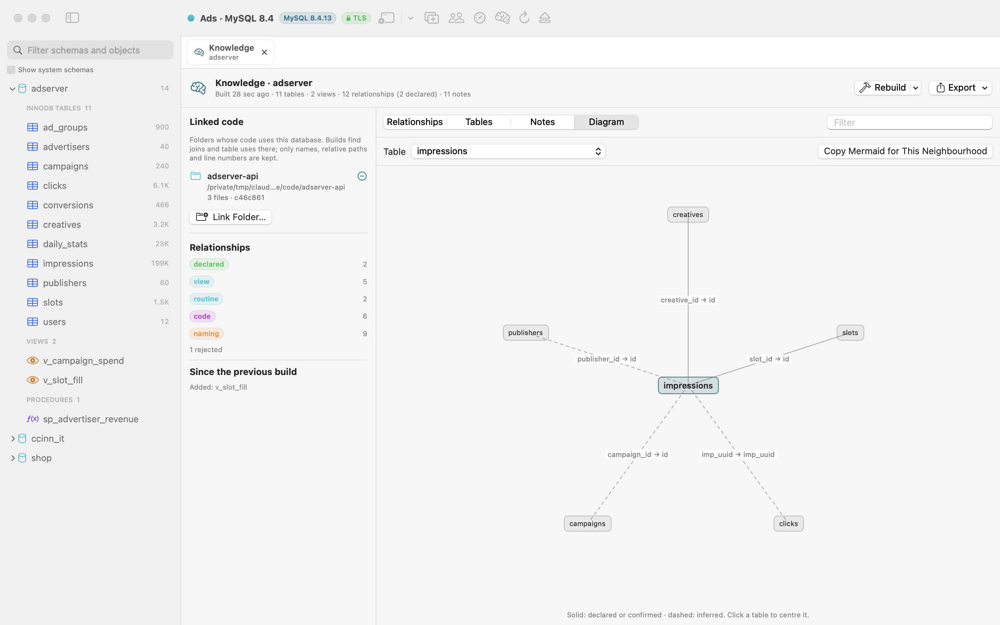

<p align="center">
  
</p>

<h1 align="center">CcinnMysql</h1>

<p align="center">
  <b>A fast, native macOS client for MySQL, MariaDB and Percona Server.</b><br>
  See who blocks whom, which statements are expensive, how far replicas lag and how close a table is to running out of AUTO_INCREMENT, read query plans as a tree — and give AI assistants a map of how your tables join.
</p>

<p align="center">
  <a href="https://github.com/whiteCcinn/ccinnmysql/actions/workflows/ci.yml"></a>
  <a href="https://github.com/whiteCcinn/ccinnmysql/releases/latest"></a>
  
  
  
  
  <a href="LICENSE"></a>
</p>

<p align="center">
  English · <a href="README.zh-CN.md">简体中文</a>
</p>

<p align="center">
  
</p>

## Why CcinnMysql?

Most MySQL GUIs stop at a table list and a query box. The questions that matter during an incident are answered by hand-written `information_schema`, `performance_schema` and `sys` queries:

- which session holds the lock everybody is waiting for,
- which statements burn the most time or scan whole tables,
- how far each replica is behind and why it stopped,
- whether a table has a primary key, redundant indexes or is about to overflow its AUTO_INCREMENT,
- what the optimizer actually does with a query.

CcinnMysql puts those answers one click away, in a native SwiftUI/AppKit app with its own pure-Swift MySQL protocol client — TLS, `caching_sha2_password`, MariaDB `ed25519` and all. No Electron, no JDBC, no bundled runtime, no telemetry.

AI assistants face the same questions with less context: every session rediscovers the schema and guesses how the tables join. CcinnMysql's [knowledge base](#knowledge-base-teach-ai-your-schema) remembers that per database — from foreign keys, view and routine definitions, query history, the code that uses the database and naming conventions — so Claude Code, Codex or Cursor start from the right joins.

## Features

- **Schema browser** — schemas with tables grouped by storage engine (InnoDB, MyISAM, MEMORY, …), views, sequences, procedures, functions, triggers and events, each with its own icon; system schemas hidden until you ask for them.
- **Table insights** — columns, indexes with per-prefix cardinality and visibility, foreign keys in both directions, partitions with bounds and sizes, row and size estimates, free space, DDL, a data preview, and findings: missing primary key, redundant or duplicate indexes, AUTO_INCREMENT headroom, non-transactional engines.
- **Processlist** — sessions with filters, auto-refresh and **Kill Query / Kill Connection**, pinned to the server that produced the list (also behind load balancers and ProxySQL).
- **InnoDB locks** — running transactions, lock waits with the waiting and the blocking statement (`performance_schema.data_locks` on MySQL 8, `information_schema.innodb_lock_waits` elsewhere), the latest detected deadlock, and a one-click "kill blocker".
- **Top statements** — `performance_schema` statement digests ranked by total or average time, executions, rows examined, full scans or errors.
- **Replication & topology** — replica channels (REPLICA and SLAVE vocabularies, MariaDB multi-source), binary log position, connected replicas, Group Replication members, Galera status, InnoDB Cluster metadata, ProxySQL detection.
- **Variables, status & users** — global/session variables, status counters with per-second rates, accounts with plugin, lock and expiry state, and their grants (read-only, credentials redacted).
- **Visual EXPLAIN** — `EXPLAIN FORMAT=JSON` (both MySQL formats and MariaDB), `EXPLAIN ANALYZE` (MySQL 8.0.18+) and MariaDB `ANALYZE FORMAT=JSON` as a tree with access types, keys, estimated vs. actual rows, costs and warnings for full scans, filesorts, temporary tables and bad estimates.
- **SQL workbench** — syntax highlighting, context-aware completion (schemas, tables, columns, aliases, functions; the table list opens as soon as you type a space after `FROM` or `JOIN`), `DELIMITER` support, automatic LIMIT for plain queries only, history (credentials redacted), copy or export as CSV, TSV, **Excel (.xlsx)** or SQL `INSERT` (one per row, or multi-row in batches of 1,000 rows / ~1 MB) — Excel keeps IDs beyond 15 digits and ZEROFILL values as exact text, shows integers in full and decimals with their scale — and instant charts.
- **Precise error markers** — a failed statement's error is underlined where it is: the token where MySQL or MariaDB stopped (also in multi-line statements, when the same text repeats, or when the server shortened its `near '…'`), or the column, table, database, function or variable the message names, using its clause (`in 'where clause'`). The message appears after the line and in a bar under the editor with its line and column; the result shows the error code and **Show in Editor**. Markers follow your edits and disappear once you change the failing statement. Unclosed quotes, comments and parentheses are flagged as you type, without contacting the server.
- **Format SQL** (⌥⌘L) — lays out the selection or the whole script: one clause per line, one list item per line, indented subqueries, CASE and `CREATE TABLE` columns. It only changes whitespace and the case of keywords every supported server reserves (`order` in `shop.order` stays a name); names, strings, comments and the spacing MySQL cares about (`COUNT(*)` vs `COUNT (*)`, `X'41'`, `\N`, `'root'@'%'`) are untouched, numbers, strings and double quotes are read exactly as the server and the session's `sql_mode` read them, `DELIMITER` scripts keep their commands, and the result is checked token by token before it replaces your text. Undo with ⌘Z. When it changes nothing, the bar under the editor says why.
- **Safe inline editing** — results from a single base table with a primary key (or a NOT NULL unique key) are editable: CcinnMysql generates the `UPDATE … WHERE <key> LIMIT 1`, shows it, and commits only when exactly one row matched.
- **Connections** — Keychain secrets, TLS modes (disabled, preferred, required, verify CA, verify identity) with custom CA and client certificates, SSH tunnels through the system OpenSSH client (never using or becoming a shared `ControlMaster` from your `~/.ssh/config`), per-connection confirmation of writes.
- **Multiple windows** — every window has its own connection, so you can put different servers side by side or keep two views of the same one. File ▸ New CcinnMysql Window (⌘N) opens the connection screen; **New Window with This Connection** (⇧⌘N, or the toolbar's New Window button) opens the current server again with the password already in use, even for unsaved connections and passwords not in the Keychain; saved connections have **Open in New Window**. Closing a window disconnects only that window.
- **MCP server** — let Claude Code, Codex, Claude Desktop or Cursor query the connections you allow, read-only by default.
- **Move to another Mac** — File ▸ Export Settings and Knowledge… writes one file with your connections, the knowledge base and its linked projects, settings and, if you like, query history; passwords only when you seal them with a passphrase. Import shows what will change before anything is written, and can be undone.
- **Knowledge base** — per database, maps how the tables relate: declared foreign keys, the joins in view, routine, trigger and event definitions, your query history, the code folders you link, and naming. AI assistants find tables, join paths and ER diagrams in it without exploring table by table, and record what they verify, with evidence, for later sessions.

## Compatibility

| Server | Versions | Verified live (Docker) |
|---|---|---|
| MySQL | 5.5, 5.6, 5.7, 8.0, 8.4 LTS, 9.6 | ✅ connect, TLS, auth plugins, metadata, operations, kill |
| Percona Server | 8.0 | ✅ |
| MariaDB | 10.11, 11.4 (10.6, 12.0 expected) | ✅ incl. `client_ed25519` |
| Primary / replica (MySQL 8.4, GTID) | | ✅ |
| Galera (MariaDB 11.4) | | ✅ single-node cluster |
| ProxySQL 2.7 | | ✅ incl. Kill Query through the proxy |
| Group Replication / InnoDB Cluster, MySQL Router | | parsing unit-tested; not run live |

| Authentication | |
|---|---|
| `mysql_native_password` | ✅ |
| `caching_sha2_password` | ✅ fast and full authentication — inside TLS, or with the server's RSA key (pinned, or retrieved when you allow it) |
| `sha256_password` | ✅ over TLS or RSA |
| MariaDB `client_ed25519` | ✅ (pure-Swift Ed25519, RFC 8032 test vectors) |
| `mysql_clear_password` | opt-in per connection (LDAP / PAM accounts) |

TLS is negotiated on the same socket after the server greeting (`SSLRequest`), like the `mysql` client. *Preferred* stays in plaintext only when the server offers no TLS at all; once a TLS handshake has started, a failure is final — CcinnMysql never retries in plaintext. Old MySQL 5.6/5.7 builds that only speak TLS 1.0/1.1 get a specific error; enable **Allow TLS 1.0 / 1.1** for that connection or use an SSH tunnel. Metadata is read from `information_schema` with `SHOW` fallbacks, always **by column name**, and features that need privileges or a newer version degrade with an explanation. CcinnMysql runs on **macOS 14 Sonoma or later** (Apple silicon and Intel).

## Screenshots

| Visual EXPLAIN ANALYZE | InnoDB lock waits |
|---|---|
|  |  |
| **Server overview** | **Replica status** |
|  |  |
| **Charts from a query (MariaDB)** | **Connection with TLS options** |
|  |  |
| **Knowledge base: relationships with their evidence and confidence** | **Knowledge base: a subject area as a Mermaid ER diagram** |
|  |  |

## Installation

1. Download `CcinnMysql-<version>.dmg` (or the `.zip`) from the [latest release](https://github.com/whiteCcinn/ccinnmysql/releases/latest).
2. Open the disk image and drag **CcinnMysql** into **Applications**.
3. The app is ad-hoc signed but not notarized. The first time, right-click the app and choose **Open**, or run:

   ```bash
   xattr -dr com.apple.quarantine /Applications/CcinnMysql.app
   ```

Each release lists SHA-256 checksums in `SHA256SUMS.txt`.

### Updating

Choose **CcinnMysql → Check for Updates…**. If a newer release exists, CcinnMysql shows what's new. **Download & Open** saves the disk image to your Downloads folder, checks it against the release's `SHA256SUMS.txt`, and opens it. Quit CcinnMysql, then drag the new version onto **Applications**.

CcinnMysql also checks quietly once a day; turn this off in **Settings → General → Updates**. The check contacts only GitHub's public releases API, and you can **Skip This Version**.

The project page, release notes and issue tracker are also in the **Help** menu and the About window.

## Quick start

1. Click **New Connection** and enter host, port (default **3306**), user and password. TLS is *Preferred* by default; choose *Verify identity* and a CA file for production servers.
2. Press **Test** — it reports the server, TLS version and authentication plugin — then **Save & Connect**.
3. Pick a table in the sidebar for its structure and insights, open **Server** (toolbar) for processlist, locks, statements and replication, or press **⌘T** for a SQL editor.

| Shortcut | Action |
|---|---|
| **⌘↩** | Run the selection or the current statement |
| **⇧⌘↩** | Run all statements |
| **⌘E** / **⇧⌘E** | Explain / Explain Analyze (runs the query) |
| **⌘.** | Cancel the running statement (`KILL QUERY`) |
| **⌃Space** | Show completions |
| **⌥⌘L** | Format SQL (selection or whole script) |
| **⌘T** | New query |
| **⌘N** | New CcinnMysql Window (another server, or the same one) |
| **⇧⌘N** | New window with this connection |
| **⌥⌘1** / **⌥⌘2** | Server overview / Processlist |
| **⇧⌘R** | Refresh schemas |
| **⇧⌘D** | Disconnect |

## MCP server: let AI query MySQL

CcinnMysql has a built-in **Model Context Protocol** server. AI assistants such as **Claude Code**, **Codex**, **Claude Desktop** or Cursor can use it to explore your servers, diagnose locks and slow statements, and run queries through your saved connections.

1. Open a connection and set **AI access (MCP)** to **Read-only** or **Read & write**. Connections are off by default.
2. Register the server. **Settings → MCP** shows these snippets with the right path, ready to copy:

   ```bash
   # Claude Code
   claude mcp add ccinnmysql -- /Applications/CcinnMysql.app/Contents/MacOS/CcinnMysql mcp
   ```

   ```toml
   # Codex (~/.codex/config.toml)
   [mcp_servers.ccinnmysql]
   command = "/Applications/CcinnMysql.app/Contents/MacOS/CcinnMysql"
   args = ["mcp"]
   ```

   ```json
   // Claude Desktop (claude_desktop_config.json) and other JSON-configured clients
   { "mcpServers": { "ccinnmysql": { "command": "/Applications/CcinnMysql.app/Contents/MacOS/CcinnMysql", "args": ["mcp"] } } }
   ```

3. Ask questions such as *"Who is blocking the update on `shop.orders`?"*, *"Which tables in `shop` have redundant indexes?"*, *"Why is this query slow?"* or *"How do I join `conversions` to `advertisers`?"*

**Tools**

| Group | Tools |
|---|---|
| Connections | `list_connections`, `server_info` |
| Schema | `list_databases`, `list_tables`, `describe_table`, `get_indexes` |
| Diagnostics | `get_processlist`, `get_innodb_status`, `get_top_statements`, `get_replication_status` |
| SQL | `run_query`, `explain_query`, and `execute_statement` (read & write connections only) |
| Knowledge (read) | `list_knowledge`, `knowledge_overview`, `search_knowledge`, `explain_table`, `find_join_path`, `er_diagram`, `refresh_knowledge` (see [Knowledge base](#knowledge-base-teach-ai-your-schema)) |
| Knowledge (write) | `link_project`, `add_notes`, `add_relationships`, `define_terms`, `define_subject_area`, `remove_knowledge` |

**Safety**

- Passwords stay in the Keychain and are never shown to the AI; only connections you enabled are visible.
- `run_query` accepts one read-only statement (`SELECT`, `WITH`, `TABLE`, `VALUES`, `SHOW`, `DESCRIBE`, `EXPLAIN`). The app checks it with its own SQL lexer — writes hidden in CTEs, `INTO OUTFILE`, locking reads, executable comments, side-effect functions (`SLEEP`, `GET_LOCK`, `LOAD_FILE`, …) and multiple statements are rejected before anything is sent.
- The server enforces it too: read-only calls run inside `START TRANSACTION READ ONLY` with `MAX_EXECUTION_TIME` / `max_statement_time`, so even a stored function that writes is refused.
- Results are capped at 1,000 rows (200 by default) and about 256 KB; statements time out after 30 s by default (max 120 s); cancelling a request sends `KILL QUERY` to the right server.
- `--read-only` caps every connection at read-only; `--profile <name>` picks the default connection.
- Every call is logged (credentials redacted, file mode 0600) to `~/Library/Application Support/CcinnMysql/mcp-audit.jsonl`.
- Each call opens its own session and closes it afterwards, so session state (user variables, `SET SESSION`, temporary tables, named locks) never carries over to the next call.
- MCP connections identify themselves to the server as `program_name = 'CcinnMysql MCP'` (with the process id in `_pid`), so DBAs can find AI sessions in `performance_schema.session_connect_attrs`.
- Read-only calls run in the server's default reading of SQL: `sql_mode`s that change it (`NO_BACKSLASH_ESCAPES`, `ANSI_QUOTES`, MariaDB's `ORACLE`, `PIPES_AS_CONCAT`, …) are removed for the call, every connection uses `utf8mb4` (also when the server switches new connections to GBK or Shift-JIS), and the call is refused if either cannot be ensured. The check runs on the exact text that is sent, after the automatic `LIMIT`.
- Password hashes and other sessions' statements are off limits: `run_query` refuses the whole `mysql`, `performance_schema` and `sys` schemas (deny by default), the `information_schema` views that show other sessions' statements (`PROCESSLIST`, `INNODB_TRX`, …), `SHOW PROCESSLIST`, `SHOW ENGINE INNODB STATUS`, `EXPLAIN FOR CONNECTION` and MariaDB's `SHOW EXPLAIN` / `SHOW ANALYZE … FOR` (another session's plan, with its values), `SHOW REPLICA STATUS` (its last error quotes a replicated statement), `SHOW BINLOG EVENTS` / `SHOW RELAYLOG EVENTS` (replicated statements), and `SHOW GRANTS` / `SHOW CREATE USER` (MariaDB's `SHOW GRANTS` prints the account's password hash). `get_processlist`, `get_innodb_status` and `get_top_statements` show other sessions' statements with every literal replaced by `?`, and `get_replication_status` replaces the quoted part of the last SQL error with `?`.
- Functions: read-only calls may use only the reviewed built-in functions of the server's flavor (checked against MySQL 8.4 and MariaDB 10.11; `REPLACE()`, `INSERT()` and `TRUNCATE()` included). Loadable (UDF), component and stored functions — qualified, back-quoted, or a built-in name written with a space before `(`, which the server then looks up as a stored function — need the connection's allowance in **Settings → MCP**, because what runs inside them can't be checked; built-ins with side effects (`SLEEP`, `GET_LOCK`, `LOAD_FILE`, …) stay refused.
- Names reach the server as checked: read-only calls refuse names and `database` arguments with a letter the servers fold to ASCII (`ı`, `İ`, `ſ`, `K`, `ß`, `fi`, …: `processlıst` is PROCESSLIST there; write names in plain letters; this also refuses legitimate names such as a German column `straße`, and back-quoting does not help: rename such a name or query it in the editor), compare other names with their deny lists by an ASCII skeleton (case, compatibility forms and accents folded, as MySQL's collations may), and refuse any argument with a control character such as NUL, which a connection could not send as written.

**What "read-only" covers.** Read-only means the AI cannot change data or schema. It cannot see inside stored functions or views that already exist on the server: a function the query calls may still have side effects such as `GET_LOCK`, `SLEEP` or `KILL` (where the server allows it in a function) while the call runs. With an account that has `FILE`, `SUPER`, `PROCESS`, any dynamic privilege not reviewed as harmless (every `*_ADMIN`, `INNODB_REDO_LOG_ARCHIVE`, …), global `ALL PRIVILEGES`, or `SELECT` on `*.*`, `mysql.*`, `performance_schema.*` or `sys.*` (also through a database pattern that matches one, such as `%`, `my%` or `m_sql`, and through a role; local `root` has all of them), such a function or view could also write or read server files, read password hashes, or show other sessions' statements (`PROCESS` sees every session in the process list), so **the read-only tools refuse these accounts** unless you allow it for that connection in **Settings → MCP**. On MariaDB an account can't read the grants of a role held through another role, so an account with nested roles can't be checked and is refused the same way. Give the MCP connection a dedicated MySQL user with only `SELECT` and `SHOW VIEW` on the databases it needs:

```sql
CREATE USER 'ai_ro'@'%' IDENTIFIED BY '…';
GRANT SELECT, SHOW VIEW ON app.* TO 'ai_ro'@'%';
GRANT PROCESS ON *.* TO 'ai_ro'@'%';                     -- optional: processlist, InnoDB status (needs the allowance)
```

The process list and InnoDB status tools need `PROCESS`, which makes the account privileged: allow it for that connection if you want them. With that allowance the AI can see other sessions' statements, literals included, through any existing invoker-rights view or routine over the process list, which the read-only check can't see into; that is the risk you accept by allowing it.

`get_top_statements` reads `performance_schema`, which needs `SELECT` there, and that makes the account privileged: allow it per connection if you want that tool. Stored functions, procedures and views created with `SQL SECURITY DEFINER` (the default) run with their definer's privileges, which no check on the AI's account can see: a definer-rights view that `root` created over the process list shows every session's statements, with their values, to any account that may select from it, whether or not that account has `PROCESS`. Refusing privileged accounts does not cover this; it is an accepted risk that the app reports: **Check account** in **Settings → MCP**, and every read-only result, list the definer-rights routines and views the account can reach whose definer is privileged (or whose privileges it cannot see).

Two environment variables exist **for the integration tests only** and are not meant for normal use: `CCINNMYSQL_PROFILE_DIR=<path>` reads profiles from another folder (the audit log goes there too), and `CCINNMYSQL_TEST_INSECURE_SECRETS_FILE=<json>` reads passwords from a JSON file instead of the Keychain.

## Knowledge base: teach AI your schema

Every new AI session otherwise rediscovers a database from scratch: it describes table after table, then guesses how they join. Most production schemas declare few foreign keys, so the guesses are often wrong, and whatever one session learns is lost. The knowledge base keeps that knowledge per database, on your Mac, and every AI session reuses it through the MCP server.

- **No AI inside the app.** CcinnMysql reads metadata (never rows) and infers what it can; your AI client, which has the repository open, reads the code and writes back what it learns through the knowledge tools.
- **One knowledge base per database**, keyed by the server's endpoint (through the SSH bastion when tunnelled), shared by every connection that reaches the server, and linked to any number of local projects. A session started in a linked project finds it with `list_knowledge`.
- **Relationships carry their evidence**, and confidence (0–100) is computed from it:

  | Source | What it finds | Confidence |
  |---|---|---|
  | `declared` | Foreign keys (InnoDB enforces them) | 100: a fact |
  | `definition` | `JOIN … ON` / `USING` / comma-join equalities in view, procedure, function, trigger and event definitions | 85 |
  | `history` | The same in the editor's successful statements | 55–90, growing with distinct statements |
  | `scan` | The same in the source files of the folders you link (Go, Java, MyBatis XML, Python, TypeScript, `.sql`, …), with file and line | 60 |
  | `code` | Code an AI read and cited (path, line, symbol) | 80 each |
  | `naming` | `user_id` → `users.id`, prefixes, plurals, `parent_id`; type-checked | 30–70 |

  Several sources combine; only declared foreign keys and what you confirmed are facts, everything else is labelled *inferred*. Your Confirm or Reject in the app always wins, and an AI can never change or remove what you wrote, confirmed or rejected.
- **Freshness.** Each table's structure has a fingerprint. When a table changes, notes and relationships written against it are marked stale until someone confirms them again; dropped tables are kept until you prune them.
- **Answers, not just pictures.** `find_join_path` returns the join chain with its `ON` conditions, a SQL skeleton and a warning when rows would multiply. `explain_table` adds notes, glossary terms, code that uses the table and hints such as its primary key. `er_diagram` draws a Mermaid diagram of one subject area, a list of tables, the tables around one, or a prefix.
- **In the app.** Click **Knowledge** in the toolbar, or right-click a database → **Knowledge Base**: refresh, review inferred relationships (Confirm / Reject), notes and glossary, the diagram of a subject area (**Copy Mermaid**), and linked projects (**Link Project…**, Remap, Unlink).
- **For AI assistants.** The MCP server's instructions tell them to call `list_knowledge` with their working directory first, then `knowledge_overview`, `search_knowledge`, `explain_table` and `find_join_path`; knowledge is built on first use. The prompts `build_knowledge` (analyse this project and a database, and record what it finds) and `answer_with_knowledge` (look things up before writing SQL) guide them; Claude Code offers them as `/mcp__ccinnmysql__build_knowledge`. Ask, for example:
  - *"Which tables do I need for daily revenue per advertiser, and how do they join?"*
  - *"Draw the ER diagram around `orders`."*
  - *"Check whether `impressions.slot_id` really references `slots.id` and record the result."*

**Storage and privacy.**
- Files live in `~/Library/Application Support/CcinnMysql/Knowledge/` (owner-only); the app and every `mcp` process share them safely. They hold structure, relationships with evidence (paths, lines, symbols, SQL digests with literals replaced) and notes, never row data.
- From code, only table and column names, relative paths and line numbers are kept, never code text.
- **Only folders you link in the app are scanned.** A project an AI links (`link_project`) helps later sessions find the knowledge, but the app never reads its code. Symbolic links, hidden folders, dependency and build folders (`node_modules`, `vendor`, `target`, …), binary files and files over 1 MB are skipped, and a scan stops at 20,000 files or 256 MB.
- Knowledge follows the account: an AI sees knowledge only for connections with AI access, and only the databases, tables and columns that connection's account can see (column grants included), even when the knowledge was built through a more privileged connection. A refresh an AI runs through such an account updates what it sees and leaves the rest as it was; only a Refresh in the app marks tables dropped. The server's own databases (`mysql`, `information_schema`, `performance_schema`, `sys`) never have knowledge.
- AI writes only local knowledge files, never the server, so it is allowed on read-only connections; turn it off per connection with **Settings → MCP → AI may write knowledge**, or for the whole server with `--no-knowledge-writes`.

**Coming from 1.5.** On first launch, CcinnMysql carries over the knowledge 1.5 left on this Mac: table and column notes (with their value meanings), glossary terms, the relationships you or an AI added, your verdicts, and linked code folders. The Knowledge tab says what came over. Table structure, computed relationships and code references are not carried over: Refresh each database to rebuild them. Knowledge of connections you have deleted since is skipped. This happens once, and the 1.5 files are left in place, so 1.5 still opens them. Backups made by 1.5 still import (see below).

## Moving to another Mac

**File ▸ Export Settings and Knowledge…** (also in **Settings → General → Backup**) writes a single `.ccinnmysql-backup` file, readable only by you:

| Part | Included | Notes |
|---|---|---|
| Connections | always | host, port, user, default database, TLS settings and certificate paths, SSH route, AI access; never SSH keys or certificate files |
| Knowledge and linked projects | on | relationships, notes, glossary, subject areas; paths under your home are written `~/…` |
| App settings | on | appearance, automatic `LIMIT`, SQL formatting, update checks; never window positions |
| Query history | off | statements with passwords removed; they may still contain table names and literal values |
| Passwords, SSH secrets, client-certificate passphrases | off | only with a passphrase (at least 12 characters, entered twice) |

**Passwords** are encrypted with AES-256-GCM under a key derived from your passphrase (PBKDF2-HMAC-SHA256, 600,000 iterations), and the passphrase also authenticates the whole file. It is never stored: lose it and the passwords cannot be recovered, but everything else still imports.

On the other Mac, **File ▸ Import Settings and Knowledge…** opens the file, asks for the passphrase (or imports without passwords), and shows a preview before writing anything:

- **Connections**: new, unchanged, or different from the one here. For a difference choose *Keep mine*, *Use imported* or *Keep both*; the newer edit is suggested. Changes that weaken security are highlighted (another server or SSH route, weaker TLS, other certificate or key files, more AI access, clear-text passwords, no confirmation before changes, the privileged-account opt-in), and from a file without a passphrase, which anyone could have written, they keep your current setting unless you choose otherwise. AI access with a privileged account is only ever taken from a passphrase-verified file.
- **Knowledge** merges item by item: nothing here is lost, deletions recorded in the backup are applied, and the newer copy of a note or term wins.
- **Projects** that are not on this Mac are marked. Point one at a folder, or move them all at once (`/Volumes/Work/code` → `~/code`).
- **Settings** show old → new, each one optional; **history** shows how many statements each connection gains.

Importing first saves your current setup (without passwords) to `Backups/` in the app's data folder, keeping the last five. The report offers **Restore Pre-Import Snapshot**, which undoes exactly what the import wrote: connections it added or replaced, the passwords it added, knowledge, history entries and settings. Connections you add or change and queries you run afterwards are kept. A password the import replaced cannot be put back; if its connection goes back to another server, the imported password is removed rather than sent there, and you enter it again. Importing the same file again changes nothing, and backups made by CcinnMysql 1.5 import the same way. After an import that changed connections, restart the MCP server in your AI clients (`/mcp` in Claude Code) so they see them.

## Building from source

Requirements: macOS 14+, Xcode 16 or later (Swift 6).

```bash
git clone https://github.com/whiteCcinn/ccinnmysql.git
cd ccinnmysql
swift build                          # debug build
swift test --skip IntegrationTests   # unit tests
scripts/build-app.sh --open          # build dist/CcinnMysql.app and launch it
scripts/package-release.sh 1.0.0     # universal .app, .zip, .dmg and checksums in dist/
```

### Integration tests against real servers

Docker is required. Containers are named `ccinnmysql-it-*`, listen on `127.0.0.1:13300–13399` and are capped at 384 MB each. The tests seed a demo `shop` schema (`scripts/seed-demo.sql`) and skip servers that are not running.

```bash
scripts/it-up.sh m57 m80 m84 mariadb1011 mariadb114   # or: all-basic; topology: r84 galera proxysql
scripts/it-wait.sh m57 m80 m84 mariadb1011 mariadb114
swift build && CCINNMYSQL_IT=1 swift test --skip-build --no-parallel --filter IntegrationTests
scripts/it-down.sh
```

## Architecture

```
CcinnMysql (SwiftUI / AppKit app, also hosts `CcinnMysql mcp`)
 └─ CcinnMysqlKit   profiles & Keychain, SQL lexer/splitter/auto-limit, error diagnostics, read-only guard, redaction,
                    completion, charts, export, history, EXPLAIN parsers, table insights, row editing, MCP server & tools,
                    knowledge base (extraction, evidence-based inference, join paths, ER diagrams, code scan, locked store),
                    settings & knowledge backup (passphrase-sealed secrets, import preview, undo)
     └─ MySQLKit    transport with in-place TLS upgrade, connection actor, pool, sessions, pinned KILL,
                    SSH tunnels, flavor/version detection, metadata and operations
         └─ MySQLWire   packet framing, handshake, SSLRequest, auth plugins (native, caching_sha2, sha256,
                        ed25519, RSA-OAEP), OK/ERR/EOF, text result sets — no I/O
```

- **One lexer for everything.** Highlighting, statement splitting, statement classification, auto-limit, error locating and checks while typing, the read-only guard, redaction and completion share one tokenizer that knows MySQL's comment rules (`-- `, `#`, `/*! … */`).
- **Kills that hit the right server.** Every connection records `CONNECTION_ID()` and the server's identity; a kill opens a separate connection and only runs `KILL QUERY` after reaching the same server (or uses the proxy's session id through ProxySQL).
- **Bounded and cancellable.** Result sets are capped, oversized results drop the connection, connects started from cancelled tasks fail immediately, and a lost transaction is reported instead of silently continuing on a new connection.
- **Concurrency safety.** Connections, pools and sessions are Swift actors; the project builds in Swift 6 strict-concurrency mode. Sorting, plan parsing, chart preparation and export run off the main thread.
- **Robust parsing.** Protocol and plan parsing is bounds-checked and fuzz-tested; malformed packets raise errors instead of crashing.

## The ccinn series

Native macOS database and storage tools that share the same design, speed and care:

| App | What it is |
|---|---|
| [**CcinnMongo**](https://github.com/whiteCcinn/ccinnmongo) | Native MongoDB client for every server from 2.6 to 8.x, with the legacy `OP_QUERY` and the modern `OP_MSG` protocols. |
| [**CcinnStarRocks**](https://github.com/whiteCcinn/ccinnstarrocks) | Native StarRocks client: partitions, tablets and skew, materialized views, running tasks, SQL with completion and charts. |
| [**CcinnRedis**](https://github.com/whiteCcinn/ccinnredis) | Native Redis client for Redis 2.8 → 8.x and Valkey, in standalone, Sentinel, Cluster and proxy deployments. |
| [**CcinnBucket**](https://github.com/whiteCcinn/ccinnbucket) | Object storage browser for Amazon S3, S3-compatible services and Alibaba Cloud OSS. |
| **CcinnMysql** *(this project)* | Native MySQL, MariaDB and Percona client: InnoDB locks, top statements, replication, visual EXPLAIN and safe inline editing. |
| [**CcinnPsql**](https://github.com/whiteCcinn/ccinnpsql) | Native PostgreSQL client. |
| [**CcinnClickHouse**](https://github.com/whiteCcinn/ccinnclickhouse) | Native ClickHouse client. |

## Contributors

- [whiteCcinn](https://github.com/whiteCcinn)

<a href="https://github.com/whiteCcinn/ccinnmysql/graphs/contributors"></a>

## Star history

[](https://star-history.com/#whiteCcinn/ccinnmysql&Date)

## Contributing

Contributions are welcome! Please read [CONTRIBUTING.md](CONTRIBUTING.md), and report security issues privately as described in [SECURITY.md](SECURITY.md).

## License

[MIT](LICENSE) © 2026 whiteCcinn. MySQL is a trademark of Oracle Corporation; MariaDB is a trademark of MariaDB plc; Percona is a trademark of Percona LLC. CcinnMysql is an independent project and is not affiliated with or endorsed by them.
