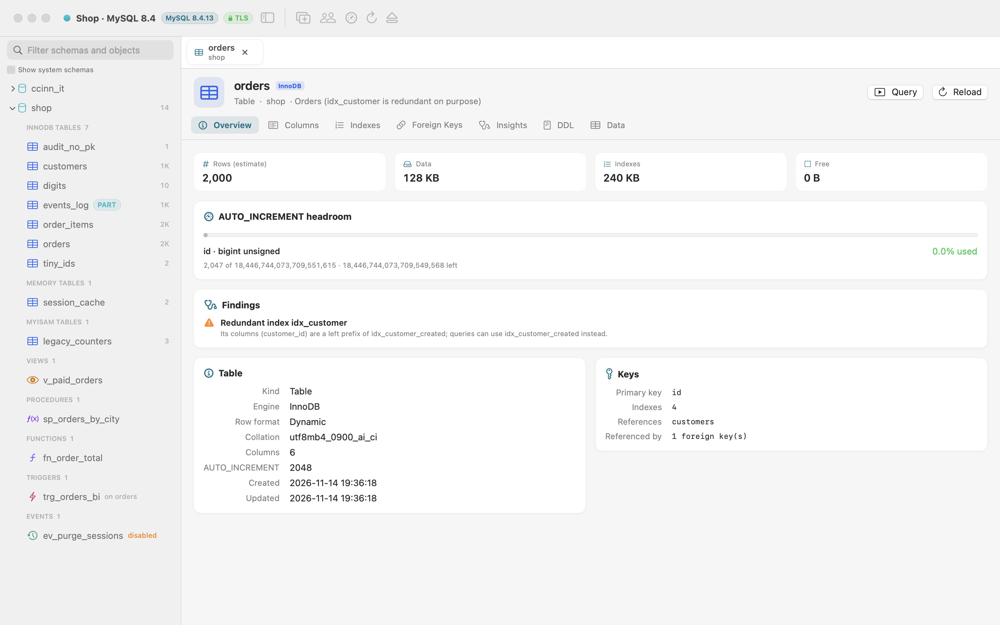
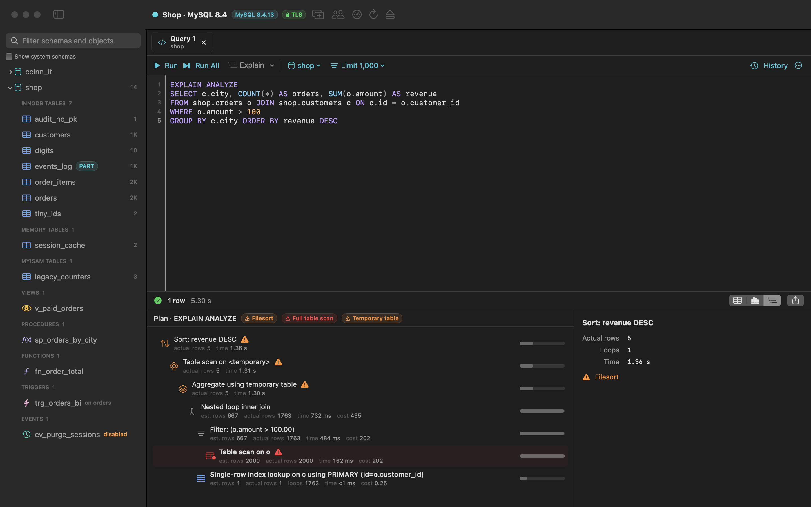
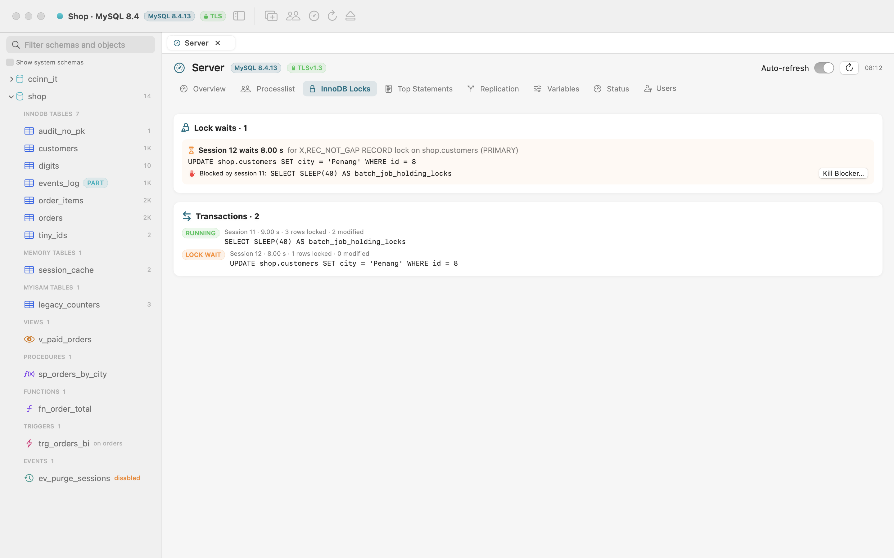
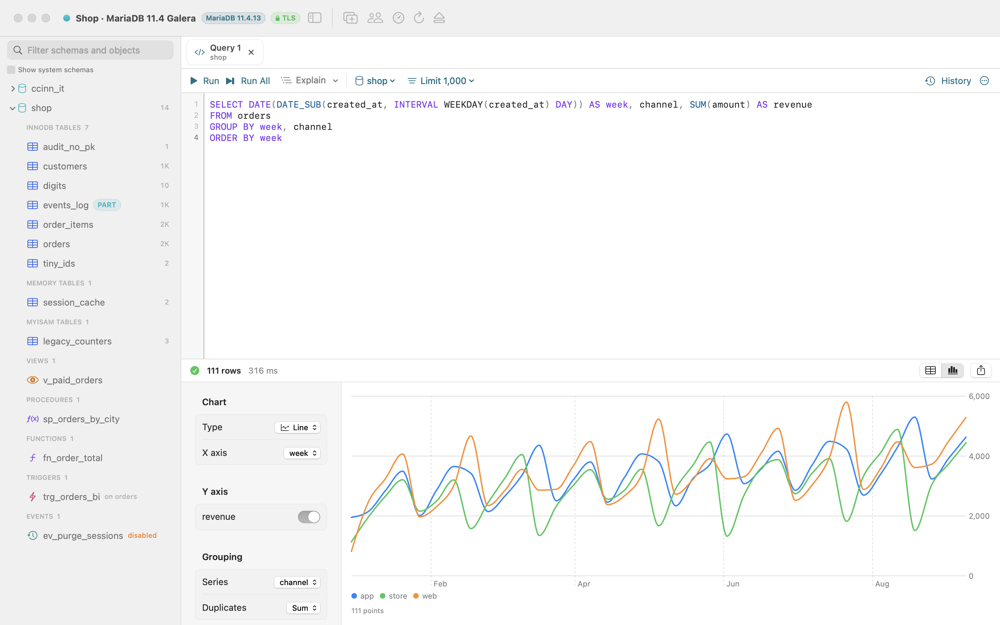
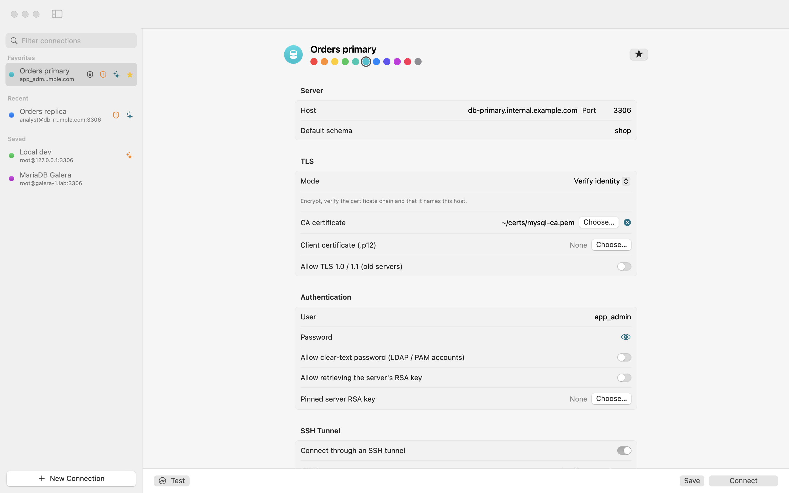

<p align="center">
  
</p>

<h1 align="center">CcinnMysql</h1>

<p align="center">
  <b>A fast, native macOS client for MySQL, MariaDB and Percona Server.</b><br>
  See who blocks whom, which statements are expensive, how far replicas lag and how close a table is to running out of AUTO_INCREMENT — and read query plans as a tree.
</p>

<p align="center">
  <a href="https://github.com/whiteCcinn/ccinnmysql/actions/workflows/ci.yml"></a>
  <a href="https://github.com/whiteCcinn/ccinnmysql/releases/latest"></a>
  
  
  
  
  <a href="LICENSE"></a>
</p>

<p align="center">
  English · <a href="README.zh-CN.md">简体中文</a>
</p>

<p align="center">
  
</p>

## Why CcinnMysql?

Most MySQL GUIs stop at a table list and a query box. The questions that matter during an incident are answered by hand-written `information_schema`, `performance_schema` and `sys` queries:

- which session holds the lock everybody is waiting for,
- which statements burn the most time or scan whole tables,
- how far each replica is behind and why it stopped,
- whether a table has a primary key, redundant indexes or is about to overflow its AUTO_INCREMENT,
- what the optimizer actually does with a query.

CcinnMysql puts those answers one click away, in a native SwiftUI/AppKit app with its own pure-Swift MySQL protocol client — TLS, `caching_sha2_password`, MariaDB `ed25519` and all. No Electron, no JDBC, no bundled runtime, no telemetry.

## Features

- **Schema browser** — schemas with tables grouped by storage engine (InnoDB, MyISAM, MEMORY, …), views, sequences, procedures, functions, triggers and events, each with its own icon; system schemas hidden until you ask for them.
- **Table insights** — columns, indexes with per-prefix cardinality and visibility, foreign keys in both directions, partitions with bounds and sizes, row and size estimates, free space, DDL, a data preview, and findings: missing primary key, redundant or duplicate indexes, AUTO_INCREMENT headroom, non-transactional engines.
- **Processlist** — sessions with filters, auto-refresh and **Kill Query / Kill Connection**, pinned to the server that produced the list (also behind load balancers and ProxySQL).
- **InnoDB locks** — running transactions, lock waits with the waiting and the blocking statement (`performance_schema.data_locks` on MySQL 8, `information_schema.innodb_lock_waits` elsewhere), the latest detected deadlock, and a one-click "kill blocker".
- **Top statements** — `performance_schema` statement digests ranked by total or average time, executions, rows examined, full scans or errors.
- **Replication & topology** — replica channels (REPLICA and SLAVE vocabularies, MariaDB multi-source), binary log position, connected replicas, Group Replication members, Galera status, InnoDB Cluster metadata, ProxySQL detection.
- **Variables, status & users** — global/session variables, status counters with per-second rates, accounts with plugin, lock and expiry state, and their grants (read-only, credentials redacted).
- **Visual EXPLAIN** — `EXPLAIN FORMAT=JSON` (both MySQL formats and MariaDB), `EXPLAIN ANALYZE` (MySQL 8.0.18+) and MariaDB `ANALYZE FORMAT=JSON` as a tree with access types, keys, estimated vs. actual rows, costs and warnings for full scans, filesorts, temporary tables and bad estimates.
- **SQL workbench** — syntax highlighting, context-aware completion (schemas, tables, columns, aliases, functions), `DELIMITER` support, automatic LIMIT for plain queries only, error underlining from `near '…' at line N`, history (credentials redacted), CSV/TSV/INSERT export and instant charts.
- **Safe inline editing** — results from a single base table with a primary key (or a NOT NULL unique key) are editable: CcinnMysql generates the `UPDATE … WHERE <key> LIMIT 1`, shows it, and commits only when exactly one row matched.
- **Connections** — Keychain secrets, TLS modes (disabled, preferred, required, verify CA, verify identity) with custom CA and client certificates, SSH tunnels through the system OpenSSH client, per-connection confirmation of writes.
- **MCP server** — let Claude Code, Codex, Claude Desktop or Cursor query the connections you allow, read-only by default.

## Compatibility

| Server | Versions | Verified live (Docker) |
|---|---|---|
| MySQL | 5.5, 5.6, 5.7, 8.0, 8.4 LTS, 9.6 | ✅ connect, TLS, auth plugins, metadata, operations, kill |
| Percona Server | 8.0 | ✅ |
| MariaDB | 10.11, 11.4 (10.6, 12.0 expected) | ✅ incl. `client_ed25519` |
| Primary / replica (MySQL 8.4, GTID) | | ✅ |
| Galera (MariaDB 11.4) | | ✅ single-node cluster |
| ProxySQL 2.7 | | ✅ incl. Kill Query through the proxy |
| Group Replication / InnoDB Cluster, MySQL Router | | parsing unit-tested; not run live |

| Authentication | |
|---|---|
| `mysql_native_password` | ✅ |
| `caching_sha2_password` | ✅ fast and full authentication — inside TLS, or with the server's RSA key (pinned, or retrieved when you allow it) |
| `sha256_password` | ✅ over TLS or RSA |
| MariaDB `client_ed25519` | ✅ (pure-Swift Ed25519, RFC 8032 test vectors) |
| `mysql_clear_password` | opt-in per connection (LDAP / PAM accounts) |

TLS is negotiated on the same socket after the server greeting (`SSLRequest`), like the `mysql` client. *Preferred* stays in plaintext only when the server offers no TLS at all; once a TLS handshake has started, a failure is final — CcinnMysql never retries in plaintext. Old MySQL 5.6/5.7 builds that only speak TLS 1.0/1.1 get a specific error; enable **Allow TLS 1.0 / 1.1** for that connection or use an SSH tunnel. Metadata is read from `information_schema` with `SHOW` fallbacks, always **by column name**, and features that need privileges or a newer version degrade with an explanation. CcinnMysql runs on **macOS 14 Sonoma or later** (Apple silicon and Intel).

## Screenshots

| Visual EXPLAIN ANALYZE | InnoDB lock waits |
|---|---|
|  |  |
| **Server overview** | **Replica status** |
|  |  |
| **Charts from a query (MariaDB)** | **Connection with TLS options** |
|  |  |

## Installation

1. Download `CcinnMysql-<version>.dmg` (or the `.zip`) from the [latest release](https://github.com/whiteCcinn/ccinnmysql/releases/latest).
2. Open the disk image and drag **CcinnMysql** into **Applications**.
3. The app is ad-hoc signed but not notarized. The first time, right-click the app and choose **Open**, or run:

   ```bash
   xattr -dr com.apple.quarantine /Applications/CcinnMysql.app
   ```

Each release lists SHA-256 checksums in `SHA256SUMS.txt`.

## Quick start

1. Click **New Connection** and enter host, port (default **3306**), user and password. TLS is *Preferred* by default; choose *Verify identity* and a CA file for production servers.
2. Press **Test** — it reports the server, TLS version and authentication plugin — then **Save & Connect**.
3. Pick a table in the sidebar for its structure and insights, open **Server** (toolbar) for processlist, locks, statements and replication, or press **⌘T** for a SQL editor.

| Shortcut | Action |
|---|---|
| **⌘↩** | Run the selection or the current statement |
| **⇧⌘↩** | Run all statements |
| **⌘E** / **⇧⌘E** | Explain / Explain Analyze (runs the query) |
| **⌘.** | Cancel the running statement (`KILL QUERY`) |
| **⌃Space** | Show completions |
| **⌘T** | New query |
| **⌥⌘1** / **⌥⌘2** | Server overview / Processlist |
| **⇧⌘R** | Refresh schemas |
| **⇧⌘D** | Disconnect |

## MCP server: let AI query MySQL

CcinnMysql has a built-in **Model Context Protocol** server. AI assistants such as **Claude Code**, **Codex**, **Claude Desktop** or Cursor can use it to explore your servers, diagnose locks and slow statements, and run queries through your saved connections.

1. Open a connection and set **AI access (MCP)** to **Read-only** or **Read & write**. Connections are off by default.
2. Register the server. **Settings → MCP** shows these snippets with the right path, ready to copy:

   ```bash
   # Claude Code
   claude mcp add ccinnmysql -- /Applications/CcinnMysql.app/Contents/MacOS/CcinnMysql mcp
   ```

   ```toml
   # Codex (~/.codex/config.toml)
   [mcp_servers.ccinnmysql]
   command = "/Applications/CcinnMysql.app/Contents/MacOS/CcinnMysql"
   args = ["mcp"]
   ```

   ```json
   // Claude Desktop (claude_desktop_config.json) and other JSON-configured clients
   { "mcpServers": { "ccinnmysql": { "command": "/Applications/CcinnMysql.app/Contents/MacOS/CcinnMysql", "args": ["mcp"] } } }
   ```

3. Ask questions such as *"Who is blocking the update on `shop.orders`?"*, *"Which tables in `shop` have redundant indexes?"* or *"Why is this query slow?"*

**Tools**

| Group | Tools |
|---|---|
| Connections | `list_connections`, `server_info` |
| Schema | `list_databases`, `list_tables`, `describe_table`, `get_indexes` |
| Diagnostics | `get_processlist`, `get_innodb_status`, `get_top_statements`, `get_replication_status` |
| SQL | `run_query`, `explain_query`, and `execute_statement` (read & write connections only) |

**Safety**

- Passwords stay in the Keychain and are never shown to the AI; only connections you enabled are visible.
- `run_query` accepts one read-only statement (`SELECT`, `WITH`, `TABLE`, `VALUES`, `SHOW`, `DESCRIBE`, `EXPLAIN`). The app checks it with its own SQL lexer — writes hidden in CTEs, `INTO OUTFILE`, locking reads, executable comments, side-effect functions (`SLEEP`, `GET_LOCK`, `LOAD_FILE`, …) and multiple statements are rejected before anything is sent.
- The server enforces it too: read-only calls run inside `START TRANSACTION READ ONLY` with `MAX_EXECUTION_TIME` / `max_statement_time`, so even a stored function that writes is refused.
- Results are capped at 1,000 rows (200 by default) and about 256 KB; statements time out after 30 s by default (max 120 s); cancelling a request sends `KILL QUERY` to the right server.
- `--read-only` caps every connection at read-only; `--profile <name>` picks the default connection.
- Every call is logged (credentials redacted, file mode 0600) to `~/Library/Application Support/CcinnMysql/mcp-audit.jsonl`.
- Each call opens its own session and closes it afterwards, so session state (user variables, `SET SESSION`, temporary tables, named locks) never carries over to the next call.
- MCP connections identify themselves to the server as `program_name = 'CcinnMysql MCP'` (with the process id in `_pid`), so DBAs can find AI sessions in `performance_schema.session_connect_attrs`.

**What "read-only" covers.** Read-only means the AI cannot change data or schema. It cannot see inside stored functions that already exist on the server: a function the query calls may still have side effects such as `GET_LOCK`, `SLEEP` or `KILL` (where the server allows it in a function) while the call runs. For real isolation, give the MCP connection a dedicated MySQL user with only `SELECT` on the databases it needs, plus `PROCESS`, `SHOW VIEW` and `SELECT` on `performance_schema` if you want the diagnostics tools:

```sql
CREATE USER 'ai_ro'@'%' IDENTIFIED BY '…';
GRANT SELECT, SHOW VIEW ON app.* TO 'ai_ro'@'%';
GRANT PROCESS ON *.* TO 'ai_ro'@'%';                     -- optional: processlist, InnoDB status
GRANT SELECT ON performance_schema.* TO 'ai_ro'@'%';     -- optional: top statements, lock waits
```

Two environment variables exist **for the integration tests only** and are not meant for normal use: `CCINNMYSQL_PROFILE_DIR=<path>` reads profiles from another folder (the audit log goes there too), and `CCINNMYSQL_TEST_INSECURE_SECRETS_FILE=<json>` reads passwords from a JSON file instead of the Keychain.

## Building from source

Requirements: macOS 14+, Xcode 16 or later (Swift 6).

```bash
git clone https://github.com/whiteCcinn/ccinnmysql.git
cd ccinnmysql
swift build                          # debug build
swift test --skip IntegrationTests   # unit tests
scripts/build-app.sh --open          # build dist/CcinnMysql.app and launch it
scripts/package-release.sh 1.0.0     # universal .app, .zip, .dmg and checksums in dist/
```

### Integration tests against real servers

Docker is required. Containers are named `ccinnmysql-it-*`, listen on `127.0.0.1:13300–13399` and are capped at 384 MB each. The tests seed a demo `shop` schema (`scripts/seed-demo.sql`) and skip servers that are not running.

```bash
scripts/it-up.sh m57 m80 m84 mariadb1011 mariadb114   # or: all-basic; topology: r84 galera proxysql
scripts/it-wait.sh m57 m80 m84 mariadb1011 mariadb114
swift build && CCINNMYSQL_IT=1 swift test --skip-build --no-parallel --filter IntegrationTests
scripts/it-down.sh
```

## Architecture

```
CcinnMysql (SwiftUI / AppKit app, also hosts `CcinnMysql mcp`)
 └─ CcinnMysqlKit   profiles & Keychain, SQL lexer/splitter/auto-limit, read-only guard, redaction, completion,
                    charts, export, history, EXPLAIN parsers, table insights, row editing, MCP server & tools
     └─ MySQLKit    transport with in-place TLS upgrade, connection actor, pool, sessions, pinned KILL,
                    SSH tunnels, flavor/version detection, metadata and operations
         └─ MySQLWire   packet framing, handshake, SSLRequest, auth plugins (native, caching_sha2, sha256,
                        ed25519, RSA-OAEP), OK/ERR/EOF, text result sets — no I/O
```

- **One lexer for everything.** Highlighting, statement splitting, statement classification, auto-limit, the read-only guard, redaction and completion share one tokenizer that knows MySQL's comment rules (`-- `, `#`, `/*! … */`).
- **Kills that hit the right server.** Every connection records `CONNECTION_ID()` and the server's identity; a kill opens a separate connection and only runs `KILL QUERY` after reaching the same server (or uses the proxy's session id through ProxySQL).
- **Bounded and cancellable.** Result sets are capped, oversized results drop the connection, connects started from cancelled tasks fail immediately, and a lost transaction is reported instead of silently continuing on a new connection.
- **Concurrency safety.** Connections, pools and sessions are Swift actors; the project builds in Swift 6 strict-concurrency mode. Sorting, plan parsing, chart preparation and export run off the main thread.
- **Robust parsing.** Protocol and plan parsing is bounds-checked and fuzz-tested; malformed packets raise errors instead of crashing.

## The ccinn series

Native macOS database and storage tools that share the same design, speed and care:

| App | What it is |
|---|---|
| [**CcinnMongo**](https://github.com/whiteCcinn/ccinnmongo) | Native MongoDB client for every server from 2.6 to 8.x, with the legacy `OP_QUERY` and the modern `OP_MSG` protocols. |
| [**CcinnStarRocks**](https://github.com/whiteCcinn/ccinnstarrocks) | Native StarRocks client: partitions, tablets and skew, materialized views, running tasks, SQL with completion and charts. |
| [**CcinnRedis**](https://github.com/whiteCcinn/ccinnredis) | Native Redis client for Redis 2.8 → 8.x and Valkey, in standalone, Sentinel, Cluster and proxy deployments. |
| [**CcinnBucket**](https://github.com/whiteCcinn/ccinnbucket) | Object storage browser for Amazon S3, S3-compatible services and Alibaba Cloud OSS. |
| **CcinnMysql** *(this project)* | Native MySQL, MariaDB and Percona client: InnoDB locks, top statements, replication, visual EXPLAIN and safe inline editing. |
| [**CcinnPsql**](https://github.com/whiteCcinn/ccinnpsql) | Native PostgreSQL client. |
| [**CcinnClickHouse**](https://github.com/whiteCcinn/ccinnclickhouse) | Native ClickHouse client. |

## Contributors

- [whiteCcinn](https://github.com/whiteCcinn)

<a href="https://github.com/whiteCcinn/ccinnmysql/graphs/contributors"></a>

## Star history

[](https://star-history.com/#whiteCcinn/ccinnmysql&Date)

## Contributing

Contributions are welcome! Please read [CONTRIBUTING.md](CONTRIBUTING.md), and report security issues privately as described in [SECURITY.md](SECURITY.md).

## License

[MIT](LICENSE) © 2026 whiteCcinn. MySQL is a trademark of Oracle Corporation; MariaDB is a trademark of MariaDB plc; Percona is a trademark of Percona LLC. CcinnMysql is an independent project and is not affiliated with or endorsed by them.
