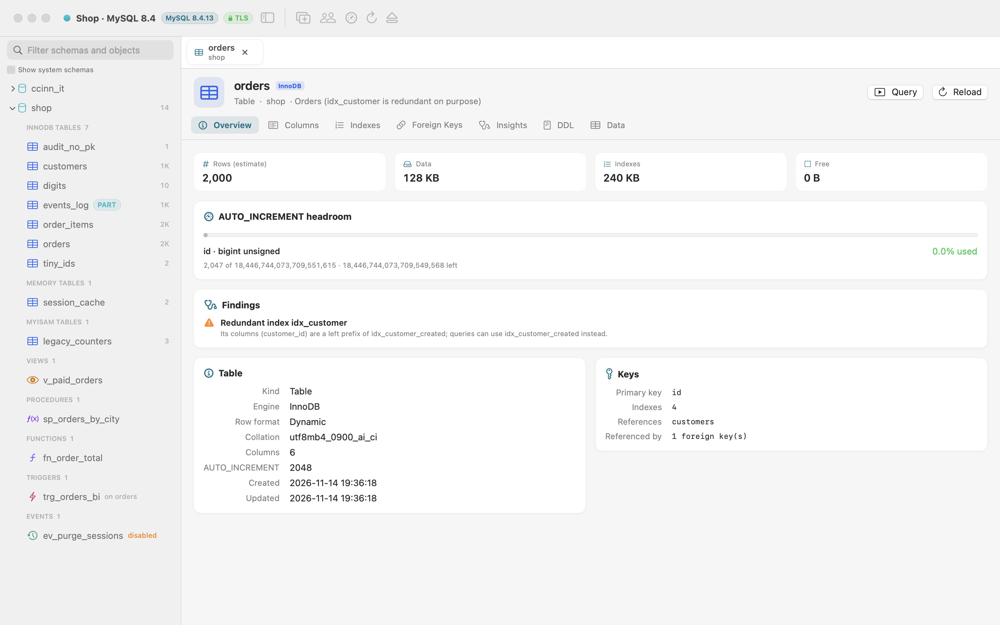
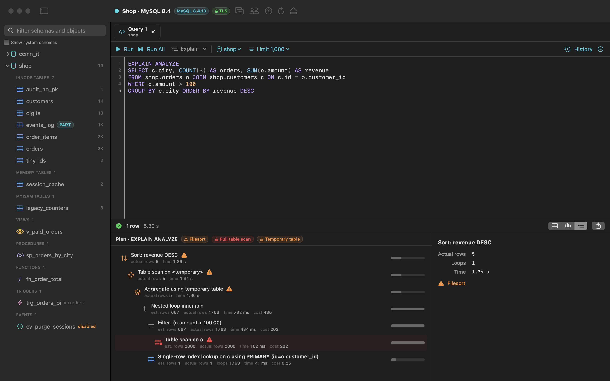
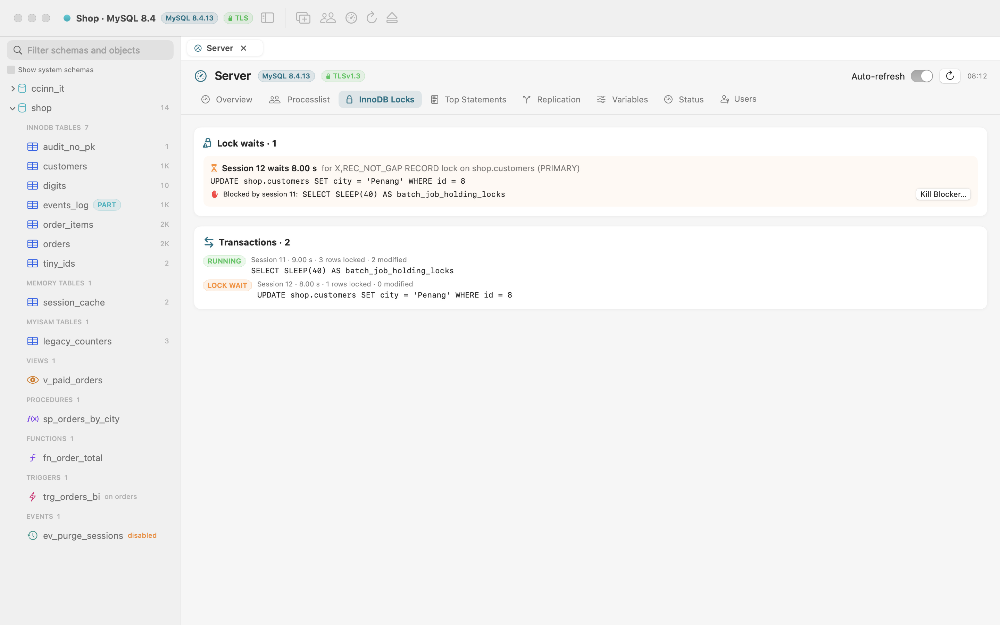
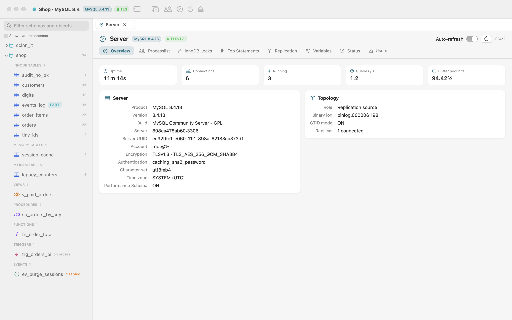
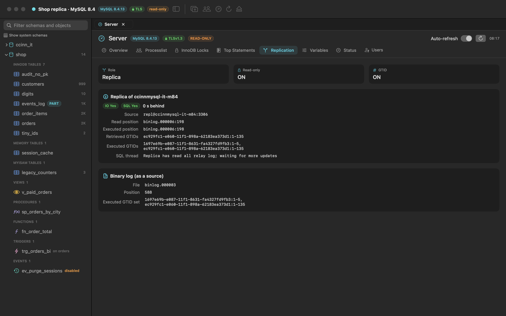
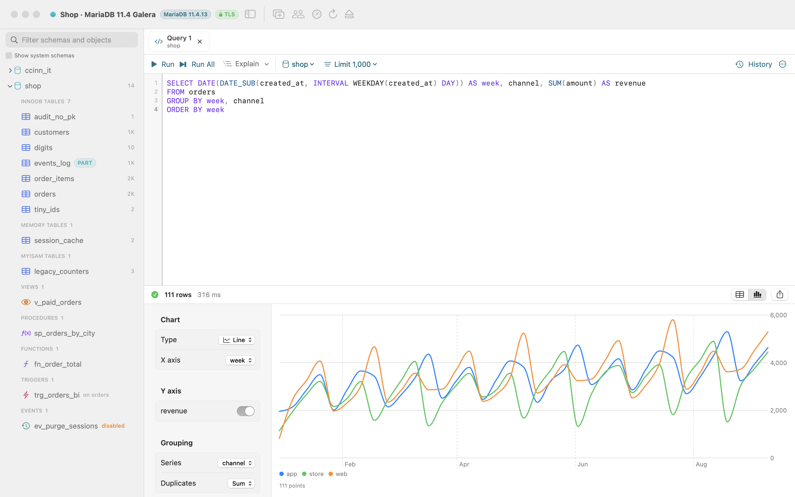
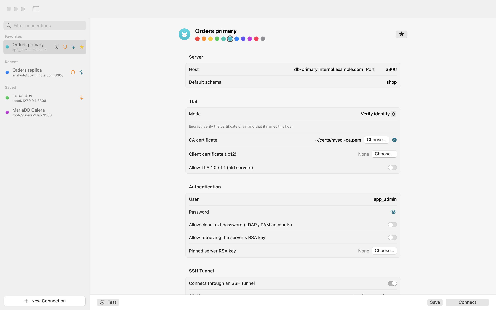
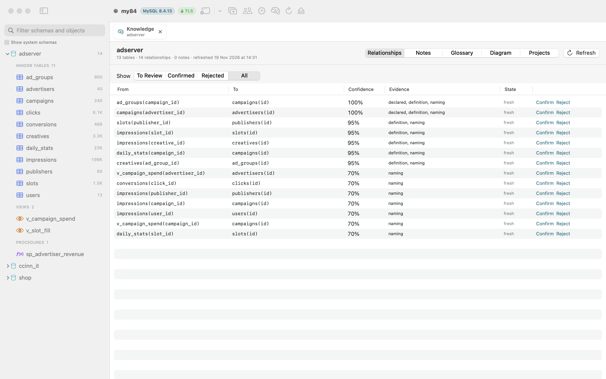
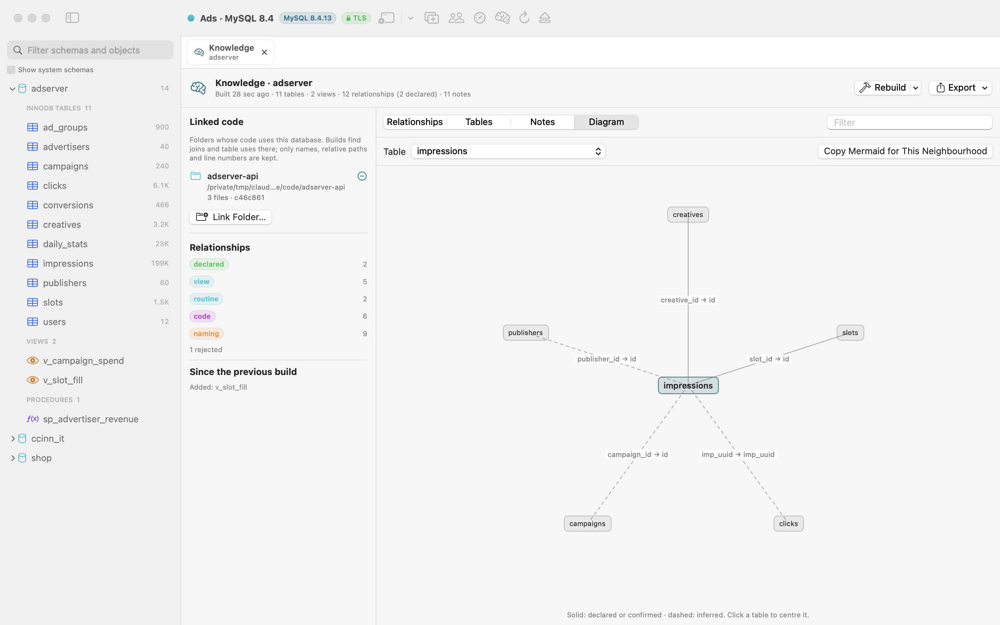

<p align="center">
  
</p>

<h1 align="center">CcinnMysql</h1>

<p align="center">
  <b>快速、原生的 macOS MySQL / MariaDB / Percona 客户端。</b><br>
  一眼看清谁在阻塞谁、哪些语句最耗资源、从库延迟多少、哪张表的 AUTO_INCREMENT 快要耗尽，以树状图阅读执行计划——还能让 AI 助手掌握各表之间如何关联。
</p>

<p align="center">
  <a href="https://github.com/whiteCcinn/ccinnmysql/actions/workflows/ci.yml"></a>
  <a href="https://github.com/whiteCcinn/ccinnmysql/releases/latest"></a>
  
  
  
  
  <a href="LICENSE"></a>
</p>

<p align="center">
  <a href="README.md">English</a> · 简体中文
</p>

<p align="center">
  
</p>

## 为什么选择 CcinnMysql？

大多数 MySQL 图形工具只提供表列表和查询框。排查故障时真正需要的答案，往往要手写 `information_schema`、`performance_schema` 和 `sys` 查询才能得到：

- 哪个会话持有大家都在等的锁；
- 哪些语句最耗时、哪些在全表扫描；
- 每个从库落后多少、为什么停止复制；
- 表有没有主键、有没有冗余索引、AUTO_INCREMENT 是否即将溢出；
- 优化器实际如何执行一条查询。

CcinnMysql 把这些答案放在一次点击之内。它是原生 SwiftUI/AppKit 应用，自带纯 Swift 实现的 MySQL 协议客户端——支持 TLS、`caching_sha2_password`、MariaDB `ed25519` 等。没有 Electron、没有 JDBC、没有捆绑运行时，也没有遥测。

AI 助手面对同样的问题，掌握的上下文却更少：每个会话都要重新摸索库表结构，再去猜表之间怎么关联。CcinnMysql 的[知识库](#知识库让-ai-了解你的库表)按数据库记住这些——来源包括外键、视图和存储例程定义、查询历史、使用该数据库的代码以及命名约定——让 Claude Code、Codex 或 Cursor 从正确的关联出发。

## 功能

- **库表浏览**：按存储引擎（InnoDB、MyISAM、MEMORY…）分组的表，以及视图、序列、存储过程、函数、触发器、事件，各有专属图标；系统库默认隐藏。
- **表洞察**：列、带每个前缀基数和可见性的索引、双向外键、带边界和大小的分区、行数与空间估算、碎片空间、DDL、表数据（每页 200 行，点击列头由服务器排序，按键值前后翻页，深页也很快），以及诊断结论：缺少主键、冗余或重复索引、AUTO_INCREMENT 余量、非事务引擎。
- **会话列表（Processlist）**：过滤、自动刷新、**终止查询 / 终止连接**；终止操作固定到产生该列表的那台服务器（负载均衡与 ProxySQL 之后同样准确）。
- **InnoDB 锁**：运行中的事务、锁等待（等待方与阻塞方的语句；MySQL 8 使用 `performance_schema.data_locks`，其他版本使用 `information_schema.innodb_lock_waits`）、最近一次死锁，以及一键"终止阻塞者"。
- **Top 语句**：按总耗时、平均耗时、执行次数、扫描行数、全表扫描或错误数排序的 `performance_schema` 语句摘要。
- **复制与拓扑**：从库通道（同时兼容 REPLICA 与 SLAVE 术语、MariaDB 多源复制）、binlog 位点、已连接的从库、Group Replication 成员、Galera 状态、InnoDB Cluster 元数据、ProxySQL 识别。
- **变量、状态与账号**：全局/会话变量、带每秒速率的状态计数器、账号的认证插件、锁定与过期状态及其授权（只读，凭据已脱敏）。
- **可视化 EXPLAIN**：将 `EXPLAIN FORMAT=JSON`（MySQL 两种格式与 MariaDB）、`EXPLAIN ANALYZE`（MySQL 8.0.18+）和 MariaDB `ANALYZE FORMAT=JSON` 展示为树，包含访问类型、索引、预估与实际行数、代价，并标出全表扫描、filesort、临时表和偏差过大的估算。
- **SQL 工作台**：语法高亮、上下文补全（库、表、CTE、列、别名、函数；在 `FROM`、`JOIN` 后输入空格即弹出表列表，每按一个键（包括退格）列表即时收窄；反引号中的名称补全后仍带反引号）、支持 `DELIMITER`、仅对普通查询自动加 LIMIT、查询历史（凭据脱敏）、复制或导出为 CSV、TSV、**Excel（.xlsx）**或 SQL `INSERT`（每行一条，或每 1,000 行 / 约 1 MB 合并为一条多行语句）——Excel 中超过 15 位的 ID 和 ZEROFILL 值保留为精确文本，整数完整显示，小数按精度显示——以及即时图表。
- **精确的错误标记**：语句执行失败时，直接在出错的位置画下划线——MySQL 或 MariaDB 停下来的那个词（多行语句、同样的文字重复出现、服务器截断了 `near '…'` 时同样准确），或者错误信息中提到的列、表、数据库、函数或变量（会参考 `in 'where clause'` 这类子句）。错误信息显示在该行末尾，以及编辑器下方的状态栏中（带行号和列号）；结果区显示错误码，并提供 **Show in Editor**。标记会随编辑移动，修改出错语句后自动消失。输入时还会即时提示未闭合的引号、注释和括号，无需连接服务器。
- **格式化 SQL**（⌥⌘L）：格式化选中内容或整个脚本——每个子句一行、列表每项一行，子查询、CASE 和 `CREATE TABLE` 的列自动缩进。只改动空白，以及所有受支持的服务器都保留的关键字的大小写（`shop.order` 中的 `order` 仍是名称）；名称、字符串、注释，以及 MySQL 在意的空格（`COUNT(*)` 与 `COUNT (*)` 不同，`X'41'`、`\N`、`'root'@'%'` 不能拆开）都原样保留，数字、字符串和双引号的读法与服务器及会话的 `sql_mode` 完全一致，`DELIMITER` 脚本的命令行也不会被改动；替换前会逐个 token 校验结果，可用 ⌘Z 撤销。如果没有做任何改动，编辑器下方的状态栏会说明原因。
- **安全的行内编辑**：来自单张基表且包含主键（或非空唯一键）的结果可直接编辑；CcinnMysql 生成 `UPDATE … WHERE <主键> LIMIT 1` 并展示给你确认，只有恰好匹配一行时才提交。
- **连接管理**：密码保存在钥匙串；TLS 模式（禁用、首选、必需、校验 CA、校验身份）支持自定义 CA 与客户端证书；通过系统 OpenSSH 建立 SSH 隧道（既不会使用、也不会成为 `~/.ssh/config` 中共享的 `ControlMaster` 连接）；可按连接要求在执行写操作前确认。
- **多窗口**：每个窗口使用独立的连接，可以把不同的服务器并排打开，也可以为同一台服务器开两个视图。文件 ▸ 新建 CcinnMysql 窗口（File ▸ New CcinnMysql Window，⌘N）打开连接页面；**New Window with This Connection**（⇧⌘N，或工具栏的 New Window 按钮）沿用当前连接和正在使用的密码再开一个窗口，未保存的连接和没有存入钥匙串的密码同样适用；已保存的连接可以右键选择 **Open in New Window**。关闭窗口只会断开该窗口自己的连接。
- **MCP 服务器**：让 Claude Code、Codex、Claude Desktop、Cursor 查询你授权的连接，默认只读。
- **迁移到新 Mac**：「文件 ▸ Export Settings and Knowledge…」把连接、知识库及关联的项目、应用设置（可选查询历史）写进一个文件；密码只有在你用口令加密时才会写入。导入前先预览所有改动，导入后可以撤销。
- **知识库**：按数据库梳理所有表之间的关系，来源包括声明的外键、视图／存储例程／触发器／事件定义中的 JOIN、你的查询历史、你关联的本地代码目录，以及命名约定。AI 助手直接从中查找相关表、连接路径和 ER 图，无需逐表探查，并把核实过的结论连同证据记录下来，供之后的会话复用。

## 兼容性

| 服务器 | 版本 | 实机验证（Docker） |
|---|---|---|
| MySQL | 5.5、5.6、5.7、8.0、8.4 LTS、9.6 | ✅ 连接、TLS、认证插件、元数据、运维、终止查询 |
| Percona Server | 8.0 | ✅ |
| MariaDB | 10.11、11.4（10.6、12.0 预期可用） | ✅ 含 `client_ed25519` |
| 主从复制（MySQL 8.4，GTID） | | ✅ |
| Galera（MariaDB 11.4） | | ✅ 单节点集群 |
| ProxySQL 2.7 | | ✅ 含经代理终止查询 |
| Group Replication / InnoDB Cluster、MySQL Router | | 解析有单元测试；未实机运行 |

| 认证方式 | |
|---|---|
| `mysql_native_password` | ✅ |
| `caching_sha2_password` | ✅ 快速认证与完整认证——在 TLS 内完成，或使用服务器 RSA 公钥（预置，或在你允许时获取） |
| `sha256_password` | ✅ 通过 TLS 或 RSA |
| MariaDB `client_ed25519` | ✅（纯 Swift Ed25519，通过 RFC 8032 测试向量） |
| `mysql_clear_password` | 需在连接中单独开启（LDAP / PAM 账号） |

TLS 与 `mysql` 客户端一样，在服务器握手包之后通过 `SSLRequest` 在同一个套接字上协商。"首选"模式只有在服务器完全不提供 TLS 时才使用明文；一旦开始 TLS 握手，失败即终止——CcinnMysql 绝不会退回明文重试。只支持 TLS 1.0/1.1 的老版本 MySQL 5.6/5.7 会得到明确的错误提示，可为该连接开启 **Allow TLS 1.0 / 1.1** 或使用 SSH 隧道。元数据从 `information_schema` 读取并带有 `SHOW` 回退，始终**按列名**解析；需要权限或更高版本的功能会给出说明而不是报错。CcinnMysql 需要 **macOS 14 Sonoma 或更高版本**（Apple 芯片与 Intel 均可）。

## 截图

| 可视化 EXPLAIN ANALYZE | InnoDB 锁等待 |
|---|---|
|  |  |
| **服务器概览** | **从库状态** |
|  |  |
| **由查询生成的图表（MariaDB）** | **带 TLS 选项的连接** |
|  |  |
| **知识库：关系及其证据与置信度** | **知识库：主题域的 Mermaid ER 图** |
|  |  |

## 安装

1. 从 [最新版本](https://github.com/whiteCcinn/ccinnmysql/releases/latest) 下载 `CcinnMysql-<版本>.dmg`（或 `.zip`）。
2. 打开磁盘映像，把 **CcinnMysql** 拖入 **应用程序**。
3. 应用为 ad-hoc 签名，未经公证。首次打开请右键选择 **打开**，或执行：

   ```bash
   xattr -dr com.apple.quarantine /Applications/CcinnMysql.app
   ```

每个版本都在 `SHA256SUMS.txt` 中提供 SHA-256 校验和。

### 更新

选择 **CcinnMysql → 检查更新…（Check for Updates…）**。如果有新版本，CcinnMysql 会显示更新内容。**下载并打开（Download & Open）** 会把磁盘映像保存到“下载”文件夹，按该版本的 `SHA256SUMS.txt` 校验后再打开。退出 CcinnMysql，然后把新版本拖到 **应用程序** 文件夹即可。

CcinnMysql 每天也会在后台自动检查一次，可以在 **设置 → 通用 → 更新** 中关闭。检查只访问 GitHub 的公开 Releases API，也可以选择 **跳过此版本（Skip This Version）**。

项目主页、发布说明和问题反馈入口也在 **帮助** 菜单和“关于”窗口中。

## 快速开始

1. 点击 **New Connection**，填写主机、端口（默认 **3306**）、用户名和密码。TLS 默认为"首选"；生产服务器建议选择"校验身份"并指定 CA 文件。
2. 点击 **Test**（会显示服务器、TLS 版本和认证插件），然后 **Save & Connect**。
3. 在侧边栏选择一张表查看结构与诊断；点击工具栏的 **Server** 查看会话、锁、语句和复制；或按 **⌘T** 打开 SQL 编辑器。

| 快捷键 | 操作 |
|---|---|
| **⌘↩** | 执行选中内容或当前语句 |
| **⇧⌘↩** | 执行全部语句 |
| **⌘E** / **⇧⌘E** | Explain / Explain Analyze（会实际执行查询） |
| **⌘.** | 取消正在执行的语句（`KILL QUERY`） |
| **⌃Space** | 显示补全 |
| **⌥⌘L** | 格式化 SQL（选中内容或整个脚本） |
| **⌘T** | 新建查询 |
| **⌘N** | 新建 CcinnMysql 窗口（New CcinnMysql Window）：连接另一台服务器，或同一台 |
| **⇧⌘N** | 用当前连接新建窗口 |
| **⌥⌘1** / **⌥⌘2** | 服务器概览 / 会话列表 |
| **⇧⌘R** | 刷新库表 |
| **⇧⌘D** | 断开连接 |

## MCP 服务器：让 AI 查询 MySQL

CcinnMysql 内置 **Model Context Protocol** 服务器。Claude Code、Codex、Claude Desktop、Cursor 等 AI 助手可以通过你保存的连接浏览服务器、诊断锁和慢语句并执行查询。

1. 打开一个连接，把 **AI access (MCP)** 设为 **Read-only** 或 **Read & write**。所有连接默认关闭。
2. 注册服务器。**Settings → MCP** 中有带正确路径的配置片段，可直接复制：

   ```bash
   # Claude Code
   claude mcp add ccinnmysql -- /Applications/CcinnMysql.app/Contents/MacOS/CcinnMysql mcp
   ```

   ```toml
   # Codex (~/.codex/config.toml)
   [mcp_servers.ccinnmysql]
   command = "/Applications/CcinnMysql.app/Contents/MacOS/CcinnMysql"
   args = ["mcp"]
   ```

   ```json
   // Claude Desktop (claude_desktop_config.json) 及其他使用 JSON 配置的客户端
   { "mcpServers": { "ccinnmysql": { "command": "/Applications/CcinnMysql.app/Contents/MacOS/CcinnMysql", "args": ["mcp"] } } }
   ```

3. 可以这样提问：*"是谁阻塞了 `shop.orders` 上的更新？"*、*"`shop` 里哪些表有冗余索引？"*、*"这条查询为什么慢？"*、*"`conversions` 怎么关联到 `advertisers`？"*

**工具**

| 分组 | 工具 |
|---|---|
| 连接 | `list_connections`、`server_info` |
| 库表 | `list_databases`、`list_tables`、`describe_table`、`get_indexes` |
| 诊断 | `get_processlist`、`get_innodb_status`、`get_top_statements`、`get_replication_status` |
| SQL | `run_query`、`explain_query`，以及 `execute_statement`（仅读写连接） |
| 知识库（读） | `list_knowledge`、`knowledge_overview`、`search_knowledge`、`explain_table`、`find_join_path`、`er_diagram`、`refresh_knowledge`（见[知识库](#知识库让-ai-了解你的库表)） |
| 知识库（写） | `link_project`、`add_notes`、`add_relationships`、`define_terms`、`define_subject_area`、`remove_knowledge` |

**安全机制**

- 密码保存在钥匙串中，绝不会展示给 AI；只有你开启的连接可见。
- `run_query` 只接受一条只读语句（`SELECT`、`WITH`、`TABLE`、`VALUES`、`SHOW`、`DESCRIBE`、`EXPLAIN`）。应用用自己的 SQL 词法分析器检查——CTE 中隐藏的写操作、`INTO OUTFILE`、加锁读、可执行注释、有副作用的函数（`SLEEP`、`GET_LOCK`、`LOAD_FILE` 等）和多语句都会在发送前被拒绝。
- 服务器端同样强制只读：只读调用在 `START TRANSACTION READ ONLY` 中执行，并设置 `MAX_EXECUTION_TIME` / `max_statement_time`，即使存储函数尝试写入也会被拒绝。
- 结果最多 1,000 行（默认 200 行）、约 256 KB；语句默认 30 秒超时（最长 120 秒）；在 AI 客户端取消请求会向正确的服务器发送 `KILL QUERY`。
- `--read-only` 把所有连接限制为只读；`--profile <名称>` 指定默认连接。
- 每次调用都记录到 `~/Library/Application Support/CcinnMysql/mcp-audit.jsonl`（凭据已脱敏，文件权限 0600）。
- 每次调用都使用独立的会话，结束后立即关闭，因此会话状态（用户变量、`SET SESSION`、临时表、命名锁）不会延续到下一次调用。
- MCP 连接会以 `program_name = 'CcinnMysql MCP'`（`_pid` 为进程号）向服务器表明身份，DBA 可以在 `performance_schema.session_connect_attrs` 中找到 AI 会话。
- 只读调用总是按服务器的默认方式解析 SQL：会改变解析方式的 `sql_mode`（`NO_BACKSLASH_ESCAPES`、`ANSI_QUOTES`、MariaDB 的 `ORACLE`、`PIPES_AS_CONCAT` 等）在调用期间被移除；每个连接都使用 `utf8mb4`（即使服务器把新连接切换为 GBK 或 Shift-JIS）；任何一项无法保证时调用会被拒绝。检查针对实际发送的文本（包括自动添加的 `LIMIT`）。
- 密码哈希和其他会话的语句不可读取：`run_query` 默认拒绝整个 `mysql`、`performance_schema` 和 `sys` 库，以及会显示其他会话语句的 `information_schema` 视图（`PROCESSLIST`、`INNODB_TRX` 等）、`SHOW PROCESSLIST`、`SHOW ENGINE INNODB STATUS`、`EXPLAIN FOR CONNECTION` 和 MariaDB 的 `SHOW EXPLAIN` / `SHOW ANALYZE … FOR`（会显示其他会话的执行计划及其中的值）、`SHOW REPLICA STATUS`（其最近错误会引用复制过来的语句）、`SHOW BINLOG EVENTS` / `SHOW RELAYLOG EVENTS`（复制过来的语句），以及 `SHOW GRANTS` / `SHOW CREATE USER`（MariaDB 的 `SHOW GRANTS` 会输出账号的密码哈希）。`get_processlist`、`get_innodb_status` 和 `get_top_statements` 显示其他会话的语句时，所有字面量都会替换为 `?`；`get_replication_status` 会把最近 SQL 错误中引号括起的部分替换为 `?`。
- 函数：只读调用只能使用服务器类型对应的、经过审查的内置函数（已在 MySQL 8.4 和 MariaDB 10.11 上验证，包括 `REPLACE()`、`INSERT()` 和 `TRUNCATE()`）。可加载函数（UDF）、组件函数和存储函数——无论是带库名限定、加反引号，还是内置函数名与 `(` 之间有空格（此时服务器会把它当作存储函数查找）——都需要在 **Settings → MCP** 中为该连接单独允许，因为无法检查其内部；有副作用的内置函数（`SLEEP`、`GET_LOCK`、`LOAD_FILE` 等）始终拒绝。
- 名称按检查时的样子到达服务器：只读调用拒绝含有会被服务器折叠成 ASCII 字母的字符（`ı`、`İ`、`ſ`、`K`、`ß`、`fi` 等，例如 `processlıst` 在服务器上就是 PROCESSLIST；请用普通字母书写名称；这也会拒绝合法的名称，例如德语列名 `straße`，加反引号也无济于事：请重命名，或在编辑器中查询）的名称和 `database` 参数，其余名称按 ASCII 骨架（折叠大小写、兼容形式和重音，与 MySQL 排序规则的处理方式一致）与拒绝列表比较，并拒绝任何含有控制字符（例如 NUL）的参数，因为连接无法按原样发送它们。

**“只读”的范围。** 只读意味着 AI 无法修改数据或表结构，但应用无法检查服务器上已有存储函数或视图的内部：查询调用的函数在执行期间仍可能产生副作用，例如 `GET_LOCK`、`SLEEP`，或在服务器允许的情况下执行 `KILL`。如果账号拥有 `FILE`、`SUPER`、`PROCESS`、任何未被审查为无害的动态权限（所有 `*_ADMIN`、`INNODB_REDO_LOG_ARCHIVE` 等）、全局 `ALL PRIVILEGES`，或对 `*.*`、`mysql.*`、`performance_schema.*`、`sys.*` 的 `SELECT`（包括通过能匹配这些库的库名模式获得，例如 `%`、`my%`、`m_sql`，以及通过角色获得；本机的 `root` 全都具备），这样的函数或视图还可能读写服务器文件、读取密码哈希，或显示其他会话的语句（`PROCESS` 能看到进程列表中的所有会话），因此**只读工具默认拒绝这类账号**，除非你在 **Settings → MCP** 中为该连接单独允许。在 MariaDB 上，账号无法读取通过其他角色间接获得的角色的权限，因此拥有嵌套角色的账号无法检查，同样会被拒绝。请为 MCP 连接使用专用的 MySQL 用户，只授予所需库的 `SELECT` 和 `SHOW VIEW` 权限：

```sql
CREATE USER 'ai_ro'@'%' IDENTIFIED BY '…';
GRANT SELECT, SHOW VIEW ON app.* TO 'ai_ro'@'%';
GRANT PROCESS ON *.* TO 'ai_ro'@'%';                     -- 可选：进程列表、InnoDB 状态（需要单独允许）
```

进程列表和 InnoDB 状态工具需要 `PROCESS` 权限，这会让账号被视为高权限账号：如果需要这些工具，请为该连接单独允许。允许之后，AI 可以通过服务器上已有的、读取进程列表的调用者权限（SQL SECURITY INVOKER）视图或例程看到其他会话的语句（包括字面量），只读检查无法看到其内部；这是允许时你所接受的风险。

`get_top_statements` 需要读取 `performance_schema`，也就需要那里的 `SELECT` 权限，这会让账号被视为高权限账号：如果需要这个工具，请为该连接单独允许。以 `SQL SECURITY DEFINER`（默认值）创建的存储函数、存储过程和视图会以定义者的权限执行，对 AI 账号的任何检查都看不到其内部：例如 `root` 创建的、读取进程列表的定义者权限视图，会向任何可以查询它的账号显示所有会话的语句及其中的值，无论该账号是否拥有 `PROCESS`。拒绝高权限账号并不能覆盖这种情况；这是一项已接受的风险，由应用报告：**Settings → MCP** 中的 **Check account** 以及每个只读结果都会列出该账号能调用、且定义者为高权限账号（或无法确认其权限）的定义者权限例程和视图。

另有两个**仅供集成测试使用**的环境变量，不应在日常使用：`CCINNMYSQL_PROFILE_DIR=<路径>` 从其他目录读取连接配置（审计日志也写到那里），`CCINNMYSQL_TEST_INSECURE_SECRETS_FILE=<json>` 从 JSON 文件而不是钥匙串读取密码。

## 知识库：让 AI 了解你的库表

没有知识库时，每个新的 AI 会话都要从零认识数据库：先一张张描述表结构，再去猜表之间怎么关联。生产环境的库大多很少声明外键，猜错是常事；而某个会话弄清楚的东西，会话结束就丢了。知识库按数据库把这些知识保存在你的 Mac 上，每个 AI 会话都通过 MCP 服务器复用它。

- **应用内不内置 AI。** CcinnMysql 只读取元数据（从不读取数据行）并做推断；打开了代码仓库的 AI 客户端负责读代码，再通过知识库工具把结论写回。
- **每个数据库一份知识库**，以服务器地址（经 SSH 隧道时包含跳板机）为键，所有连到该服务器的连接共享，并可关联任意多个本地项目。在已关联项目中启动的会话用 `list_knowledge` 即可找到。
- **每条关系都带证据**，置信度（0–100）由证据计算：

  | 来源 | 发现什么 | 置信度 |
  |---|---|---|
  | `declared` | 外键（InnoDB 强制执行） | 100：事实 |
  | `definition` | 视图、存储过程、函数、触发器和事件定义中的 `JOIN … ON` / `USING` / 逗号连接等值条件 | 85 |
  | `history` | 编辑器中执行成功的语句里的同类连接 | 55–90，随不同语句数增加 |
  | `scan` | 你关联的代码目录中的源文件（Go、Java、MyBatis XML、Python、TypeScript、`.sql` 等）里的同类连接，带文件和行号 | 60 |
  | `code` | AI 读过并引用的代码（路径、行号、符号） | 每条 80 |
  | `naming` | `user_id` → `users.id`、前缀、复数、`parent_id`；带类型检查 | 30–70 |

  多个来源会合并；只有声明的外键和你确认过的才算事实，其余一律标注为*推断*。你在应用里的「确认 / 否定」始终优先，AI 永远无法修改或删除你写下、确认或否定的内容。
- **新鲜度。** 每张表的结构都有指纹。表结构变化后，基于旧结构写下的说明和关系会标为过期，直到有人重新确认；已删除的表会保留，直到你手动清理。
- **给答案，而不只是画图。** `find_join_path` 返回连接路径、`ON` 条件、SQL 骨架，并在行数会被放大时给出警告。`explain_table` 还给出说明、术语、使用这张表的代码以及主键等提示。`er_diagram` 按主题域、表清单、某张表的周边或名称前缀生成 Mermaid 图。
- **在应用中。** 点工具栏的 **Knowledge**，或右键数据库 → **Knowledge Base**：刷新、审核推断出的关系（确认 / 否定）、说明与术语表、主题域的 ER 图（**Copy Mermaid**），以及关联的项目（**Link Project…**、重新定位、取消关联）。
- **AI 助手如何使用。** MCP 服务器的说明会引导 AI 先用工作目录调用 `list_knowledge`，再用 `knowledge_overview`、`search_knowledge`、`explain_table` 和 `find_join_path`；知识库在首次使用时自动建立。提示词 `build_knowledge`（分析当前项目和一个数据库并记录结论）和 `answer_with_knowledge`（写 SQL 前先查知识库）引导 AI，Claude Code 中可用 `/mcp__ccinnmysql__build_knowledge` 调用。可以这样提问：
  - *“按广告主统计每日收入需要哪些表？它们怎么关联？”*
  - *“画出 `orders` 周边的 ER 图。”*
  - *“检查 `impressions.slot_id` 是否真的引用 `slots.id`，并记录结果。”*

**存储与隐私。**
- 文件保存在 `~/Library/Application Support/CcinnMysql/Knowledge/`（仅本人可读写），应用与所有 `mcp` 进程可安全地同时使用。其中只有结构、带证据的关系（路径、行号、符号、字面量已替换的 SQL 摘要）和说明，没有任何数据行。
- 从代码中只保留表名、列名、相对路径和行号，从不保存代码文本。
- **只扫描你在应用中关联的目录。** AI 关联的项目（`link_project`）只用于帮后续会话找到知识库，应用不会读取其中的代码。符号链接、隐藏目录、依赖与构建目录（`node_modules`、`vendor`、`target` 等）、二进制文件和超过 1 MB 的文件都会跳过；扫描最多 20,000 个文件或 256 MB。
- 知识库跟随账号权限：AI 只能看到已开启 AI 访问的连接的知识库，并且只包含该连接账号能看到的数据库、表和列（包括列级授权）——即使知识库是通过权限更高的连接建立的。AI 通过这类账号刷新时，只更新它能看到的部分，其余保持原样；只有在应用中点 Refresh 才会把表标记为已删除。服务器自带的数据库（`mysql`、`information_schema`、`performance_schema`、`sys`）不会建立知识库。
- AI 只写本机的知识库文件，从不改动服务器，因此只读连接也允许写；可在 **Settings → MCP → AI may write knowledge** 按连接关闭，或用 `--no-knowledge-writes` 对整个服务关闭。

**从 1.5 升级。** 首次启动时，CcinnMysql 会把 1.5 留在这台 Mac 上的知识库迁移过来：表和列的说明（含取值含义）、术语表、你或 AI 添加的关系、你的确认／否决结论，以及关联的代码目录。知识库标签页会显示迁移了哪些内容。表结构、推算出的关系和代码引用不会迁移，请对每个数据库点 Refresh 重新生成；已删除连接的知识库会被跳过。迁移只进行一次，1.5 的文件原样保留，1.5 仍能打开。1.5 生成的备份文件也可以照样导入（见下文）。

## 迁移到另一台 Mac

**文件 ▸ Export Settings and Knowledge…**（也可在 **Settings → General → Backup** 中找到）会写出一个只有你本人可读的 `.ccinnmysql-backup` 文件：

| 内容 | 默认 | 说明 |
|---|---|---|
| 连接 | 总是包含 | 主机、端口、用户、默认数据库、TLS 设置与证书路径、SSH 路由、AI 访问权限；从不包含 SSH 私钥或证书文件 |
| 知识库及关联项目 | 开 | 关系、说明、术语表、主题域；位于主目录下的路径写成 `~/…` |
| 应用设置 | 开 | 外观、自动 `LIMIT`、SQL 格式化、更新检查；不包含窗口位置 |
| 查询历史 | 关 | 已去除其中的密码，但仍可能包含表名和字面量 |
| 密码、SSH 密钥口令、客户端证书口令 | 关 | 只有设置口令（至少 12 个字符，输入两次）时才包含 |

**密码**使用 AES-256-GCM 加密，密钥由口令派生（PBKDF2-HMAC-SHA256，60 万次迭代），口令同时校验整个文件未被篡改。口令不会被保存：遗失后密码无法恢复，但其余内容仍可导入。

在另一台 Mac 上选择 **文件 ▸ Import Settings and Knowledge…**：打开文件，输入口令（或选择不导入密码），在写入任何内容之前先看到预览：

- **连接**：新增、未变化，或与本机不同。不同时可选「保留本机（Keep mine）」「使用导入（Use imported）」「两者都保留（Keep both）」，默认建议较新的修改。会降低安全性的改动会被高亮（换了服务器或 SSH 路由、更弱的 TLS、换了证书或密钥文件、更多 AI 权限、明文密码、执行修改前不再确认、允许 AI 使用特权账号）；对于没有口令、任何人都可能写出的文件，这些改动默认保留本机设置，除非你另行选择。允许 AI 使用特权账号这一项只会从经口令校验的文件导入。
- **知识库**逐条合并：本机内容不会丢失，备份中记录的删除会生效，说明和术语以较新的版本为准。
- **项目**若不在本机会被标出。可以为单个项目指定文件夹，也可以一次性替换公共前缀（`/Volumes/Work/code` → `~/code`）。
- **设置**显示「旧值 → 新值」，每项可单独取消；**历史**显示每个连接新增多少条语句。

导入前会先把当前配置（不含密码）保存到应用数据目录下的 `Backups/`，保留最近 5 份。导入报告提供 **Restore Pre-Import Snapshot**，只撤销这次导入写入的内容：它新增或替换的连接、新增的密码、知识库、历史记录和设置；导入之后你新建或修改的连接、执行的查询都会保留。被导入替换的密码无法恢复；如果该连接因此回到另一台服务器，导入的密码会被删除而不会发往那里，需要重新输入。同一个文件再次导入不会产生任何改动，CcinnMysql 1.5 生成的备份文件也可以照样导入。若导入改动了连接，请在 AI 客户端中重启 MCP 服务（Claude Code 中用 `/mcp`），让它读到新的连接。

## 从源码构建

要求：macOS 14+、Xcode 16 或更高版本（Swift 6）。

```bash
git clone https://github.com/whiteCcinn/ccinnmysql.git
cd ccinnmysql
swift build                          # 调试构建
swift test --skip IntegrationTests   # 单元测试
scripts/build-app.sh --open          # 构建 dist/CcinnMysql.app 并启动
scripts/package-release.sh 1.0.0     # 在 dist/ 生成通用二进制 .app、.zip、.dmg 和校验和
```

### 针对真实服务器的集成测试

需要 Docker。容器命名为 `ccinnmysql-it-*`，监听 `127.0.0.1:13300–13399`，每个限制 384 MB 内存。测试会导入演示库 `shop`（`scripts/seed-demo.sql`），并跳过未运行的服务器。

```bash
scripts/it-up.sh m57 m80 m84 mariadb1011 mariadb114   # 或 all-basic；拓扑：r84 galera proxysql
scripts/it-wait.sh m57 m80 m84 mariadb1011 mariadb114
swift build && CCINNMYSQL_IT=1 swift test --skip-build --no-parallel --filter IntegrationTests
scripts/it-down.sh
```

## 架构

```
CcinnMysql（SwiftUI / AppKit 应用，同时提供 `CcinnMysql mcp`）
 └─ CcinnMysqlKit   连接配置与钥匙串、SQL 词法/分句/自动 LIMIT、错误诊断、只读守卫、脱敏、
                    补全、图表、导出、历史、EXPLAIN 解析、表洞察、行编辑、MCP 服务器与工具、
                    知识库（提取、基于证据的推断、连接路径、ER 图、代码扫描、加锁存储）、
                    设置与知识库备份（口令加密的密钥、导入预览、撤销）
     └─ MySQLKit    支持就地 TLS 升级的传输层、连接 actor、连接池、会话、固定到服务器的 KILL、
                    SSH 隧道、发行版/版本识别、元数据与运维
         └─ MySQLWire   数据包分帧、握手、SSLRequest、认证插件（native、caching_sha2、sha256、
                        ed25519、RSA-OAEP）、OK/ERR/EOF、文本结果集——不含 I/O
```

- **一个词法分析器贯穿全部功能。** 高亮、分句、语句分类、自动 LIMIT、错误定位与输入时检查、只读守卫、脱敏和补全共用一个懂 MySQL 注释规则（`-- `、`#`、`/*! … */`）的分词器。
- **终止操作命中正确的服务器。** 每个连接都会记录 `CONNECTION_ID()` 与服务器身份；终止时新建连接，只有确认到达同一台服务器后才执行 `KILL QUERY`（经 ProxySQL 时使用代理会话 ID）。
- **有界且可取消。** 结果集有上限，超大结果会丢弃连接；已取消的任务发起的连接会立即失败；事务中途断线会明确报告，而不是悄悄在新连接上继续。
- **并发安全。** 连接、连接池和会话都是 Swift actor，项目在 Swift 6 严格并发模式下构建；排序、计划解析、图表准备和导出都不在主线程执行。
- **健壮的解析。** 协议与执行计划解析都做了边界检查和模糊测试；畸形数据包只会报错，不会崩溃。

## ccinn 系列

设计、速度与用心一脉相承的原生 macOS 数据库与存储工具：

| 应用 | 简介 |
|---|---|
| [**CcinnMongo**](https://github.com/whiteCcinn/ccinnmongo) | 原生 MongoDB 客户端，支持 2.6 到 8.x 的所有服务器，兼容旧的 `OP_QUERY` 与新的 `OP_MSG` 协议。 |
| [**CcinnStarRocks**](https://github.com/whiteCcinn/ccinnstarrocks) | 原生 StarRocks 客户端：分区、Tablet 与数据倾斜、物化视图、运行中任务、带补全和图表的 SQL。 |
| [**CcinnRedis**](https://github.com/whiteCcinn/ccinnredis) | 原生 Redis 客户端，支持 Redis 2.8 → 8.x 与 Valkey，覆盖单机、Sentinel、Cluster 和代理部署。 |
| [**CcinnBucket**](https://github.com/whiteCcinn/ccinnbucket) | 对象存储浏览器，支持 Amazon S3、S3 兼容服务和阿里云 OSS。 |
| **CcinnMysql**（本项目） | 原生 MySQL、MariaDB、Percona 客户端：InnoDB 锁、Top 语句、复制、可视化 EXPLAIN 与安全的行内编辑。 |
| [**CcinnPsql**](https://github.com/whiteCcinn/ccinnpsql) | 原生 PostgreSQL 客户端。 |
| [**CcinnClickHouse**](https://github.com/whiteCcinn/ccinnclickhouse) | 原生 ClickHouse 客户端。 |

## 贡献者

- [whiteCcinn](https://github.com/whiteCcinn)

<a href="https://github.com/whiteCcinn/ccinnmysql/graphs/contributors"></a>

## Star 历史

[](https://star-history.com/#whiteCcinn/ccinnmysql&Date)

## 参与贡献

欢迎贡献！请阅读 [CONTRIBUTING.md](CONTRIBUTING.md)；安全问题请按 [SECURITY.md](SECURITY.md) 私下报告。

## 许可证

[MIT](LICENSE) © 2026 whiteCcinn。MySQL 是 Oracle Corporation 的商标；MariaDB 是 MariaDB plc 的商标；Percona 是 Percona LLC 的商标。CcinnMysql 是独立项目，与上述公司无关联，也未获其背书。
